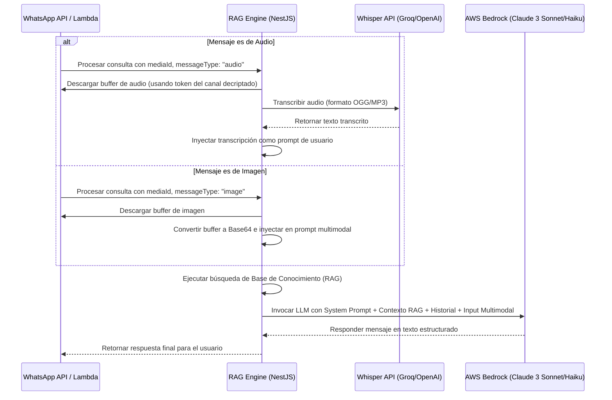

# Especificación Técnica: Procesamiento Multimodal de Imágenes y Audio

Esta especificación describe el diseño de la capacidad multimodal integrada en el **Motor de Agente RAG** (y extendida a todos los tipos de agentes en la plataforma: `rag`, `cotizador` y `agendamiento`) para permitir la recepción, descarga, transcripción y análisis nativo de mensajes de audio e imágenes sobre canales conversacionales (como WhatsApp).

---

## 1. Arquitectura de Flujo de Datos

El motor de procesamiento RAG es agnóstico del canal de comunicación a nivel de transporte, pero colabora con los adaptadores de canal (ej. `incoming-processor.handler` de WhatsApp) para descargar el material multimedia de forma segura.

### 1.1 Diagrama de Secuencia de Procesamiento Multimodal



---

## 2. Contratos de Datos y DTOs

### 2.1 payload de Entrada al RAG (`RagProcessInput`)

La interfaz `RagProcessInput` se amplió para recibir opcionalmente campos de metadatos de medios:

```typescript
export interface RagProcessInput {
  agentId: string;
  conversationId: string;
  userMessage?: string;       // Opcional si solo se envía una imagen
  timestamp: Date;
  channelId?: string;         // Requerido para resolver credenciales de descarga de medios
  messageType?: 'text' | 'audio' | 'image' | 'document';
  mediaId?: string;           // Identificador único del recurso multimedia
  mimeType?: string;          // Tipo MIME (ej. image/jpeg, audio/ogg)
}
```

### 2.2 Estructura del Prompt Multimodal (`LlmPrompt`)

El proveedor de LLM (`BedrockLlmProvider`) recibe la interfaz `LlmPrompt` la cual contiene los fragmentos textuales y una estructura de imagen opcional:

```typescript
export interface LlmPrompt {
  systemPrompt: string;
  userMessage: string;
  history: Array<{ role: 'user' | 'assistant'; content: string }>;
  contextFragments: string[];
  image?: {
    base64: string;           // Contenido de la imagen codificado en Base64
    mediaType: string;        // Tipo MIME exacto (ej. image/jpeg, image/png)
  };
}
```

---

## 3. Detalles de Implementación

### 3.1 Transcripción de Audio
- El RAG Engine obtiene el token de acceso del canal conversacional desencriptándolo mediante la clave maestra del entorno.
- Utiliza la API HTTP de WhatsApp Cloud para descargar el binario del audio en formato OGG/OPUS.
- Envía el audio a través de un cliente multipart/form-data a la API de Whisper (Groq/OpenAI) usando la clave de API configurada en el entorno (`GROQ_API_KEY`).
- El texto transcrito reemplaza o complementa al `userMessage`. Si el texto resultante es irrelevante (por ejemplo: "Necesito que me ayudes a hacer un avioncito de papel"), el motor lo detecta y rechaza escalarlo innecesariamente comparando contra las directivas del sistema y la base de conocimientos.

### 3.2 Inyección Multimodal en AWS Bedrock
Para procesar imágenes, los payloads enviados a Bedrock (`anthropic.claude-3-sonnet` o `anthropic.claude-3-haiku`) usan el formato estructurado por partes:

```json
{
  "anthropic_version": "bedrock-2023-05-31",
  "max_tokens": 1000,
  "system": "System Prompt con instrucciones del Agente...",
  "messages": [
    {
      "role": "user",
      "content": [
        {
          "type": "image",
          "source": {
            "type": "base64",
            "media_type": "image/jpeg",
            "data": "/9j/4AAQSkZJR..."
          }
        },
        {
          "type": "text",
          "text": "Mensaje opcional del usuario acompañando la imagen"
        }
      ]
    }
  ]
}
```

### 3.3 Soporte Multimodal en Agentes con Herramientas (Cotizador/Agendamiento)
Para los agentes que ejecutan flujos estructurados con herramientas (`tipo: 'cotizador'` o `tipo: 'agendamiento'`), el sistema utiliza `executeAgentWithTools` para orquestar llamadas al modelo LangChain.
Cuando se procesa una consulta que contiene una imagen base64 para estos agentes, el mensaje de usuario actual (`HumanMessage`) se inyecta con formato estructurado multipartes de manera idéntica al proveedor base:

```typescript
    if (prompt.image) {
      messages.push(
        new HumanMessage({
          content: [
            { type: 'text', text: prompt.userMessage || 'Analiza esta imagen.' },
            {
              type: 'image_url',
              // @ts-expect-error - Bedrock Converse API requiere un campo 'name' para bloques multimedia
              name: 'my_image_input',
              image_url: {
                url: `data:${prompt.image.mimeType};base64,${prompt.image.base64}`,
              },
            },
          ] as any,
        }),
      );
    } else {
      messages.push(new HumanMessage(prompt.userMessage));
    }
```

Esto asegura que tanto el Agente de RAG Estándar como los Agentes de Negocio con herramientas (como el cotizador de productos y agendamiento de citas) cuenten con acceso a los bloques visuales decodificados de forma nativa en AWS Bedrock.

---

## 4. Criterios de Aceptación y Pruebas

- **Descarga Segura:** El token del canal debe ser desencriptado bajo demanda y no almacenarse expuesto en texto plano en memoria ni logs.
- **Resiliencia de Media:** Si la descarga de la imagen o del audio falla, el agente debe responder con un mensaje informando que no pudo procesar el archivo en ese momento, en lugar de generar un error 500.
- **No-Alucinación:** Si la imagen no está relacionada con la base de conocimientos del agente, el sistema debe denegar el escalamiento a humano, respondiendo cordialmente que el tema está fuera de su alcance.
- **Soporte de Formatos:** Debe soportar archivos de imagen `image/jpeg`, `image/png`, `image/webp` y formatos de audio `audio/ogg`, `audio/mp3`, `audio/wav`.
