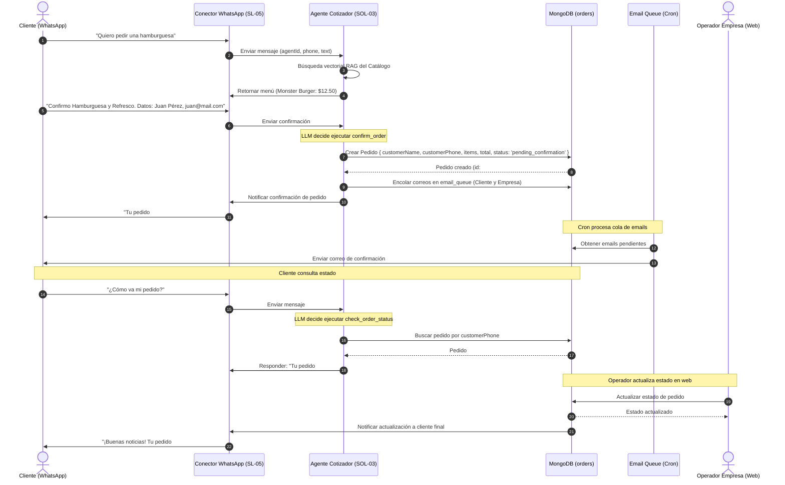

# Motor de Agente Cotizador

## 1. Overview

### Contexto
El **Motor de Agente Cotizador** (SOL-03) es una solución núcleo de la "Plataforma de Agentes Conversacionales". Permite a los agentes con tipo `cotizador` interactuar con clientes de forma autónoma a través de canales de mensajería (principalmente WhatsApp) para presentarles un catálogo de productos/servicios, armar cotizaciones dinámicas a medida, confirmar pedidos y notificar al comercio y al cliente sobre el estado y avance de su solicitud.

### Relación con la iniciativa
Esta solución implementa las capacidades del core identificadas en la Fase 3 del mapa de soluciones:
*   **Consulta de Catálogo (vía RAG)**: Delegar la búsqueda e interpretación de productos, precios y disponibilidad en la base de conocimientos documental cargada en el motor RAG.
*   **Armado de Cotizaciones**: Registrar de forma conversacional los artículos de interés del usuario y calcular los totales del pedido usando una herramienta de cotización.
*   **Confirmación de Pedido**: Registrar formalmente el pedido en base de datos sin procesar pasarelas de pago (fuera de alcance), marcándolo como pendiente de validación por la empresa.
*   **Cancelación de Pedido**: Permitir al usuario cancelar un pedido pendiente a través del bot.
*   **Seguimiento y Consulta de Estado**: Permitir a los usuarios consultar el estado de su orden por WhatsApp, y a los operadores cambiar el estado del pedido en la interfaz administrativa.
*   **Notificación Multi-canal**: Alertar inmediatamente sobre nuevos pedidos y cambios de estado a la plataforma web (inbox/notificaciones), vía WhatsApp al usuario y mediante cola de correo (Elastic Email).

### Dependencias

| Solución | Relación |
|----------|----------|
| [Conector de WhatsApp](file:///home/st-t/Desktop/MultiBotsAgent/Documentacion/plataforma-agentes-conversacionales/solutions/SL05-conector-whatsapp/conector-whatsapp.md) | Canal — Recibe mensajes del cliente y envía las respuestas del bot, confirmaciones y actualizaciones de estado del pedido. |
| [Gestión de Memoria Conversacional](file:///home/st-t/Desktop/MultiBotsAgent/Documentacion/plataforma-agentes-conversacionales/solutions/SOL-07-gestion-memoria-conversacional/gestion-memoria-conversacional.md) | Colaborador — Almacena el historial conversacional y contexto de la orden. |
| [Panel de Administración Web](file:///home/st-t/Desktop/MultiBotsAgent/Documentacion/plataforma-agentes-conversacionales/solutions/SL01-panel-administracion-web/panel-administracion-web.md) | Consumidor — Provee la UI para la visualización de pedidos en el módulo de Pedidos, y el cambio manual de estados de entrega. |

---

## 2. Solution Narrative

### 2.1 Flujo de Consulta de Catálogo y Cotización (Happy Path)

**Trigger:** Un cliente envía un mensaje por WhatsApp diciendo: "Hola, me gustaría conocer los precios de las hamburguesas y armar un pedido".

**Comportamiento:**
1. El **Conector de WhatsApp** enruta el mensaje al endpoint del agente (`/internal/agents/:agentId/process`).
2. El backend de NestJS recupera la configuración del agente (tipo `cotizador`) y asocia el historial de la conversación.
3. Se realiza una búsqueda vectorial en la base de conocimientos RAG usando el mensaje del usuario. Los fragmentos del documento de catálogo (ej. *"Hamburguesa Monster: $12.50. Refresco de lata: $2.00"*) son re-rankeados e inyectados en el contexto del prompt del LLM.
4. El LLM interpreta la información del catálogo inyectada y responde al cliente listando de manera amigable los productos y precios.
5. El cliente contesta: "Quiero una Hamburguesa Monster y un refresco de lata".
6. El LLM genera una llamada a la herramienta `build_quotation` enviando el listado estructurado de ítems con los precios extraídos de los documentos:
   ```json
   {
     "items": [
       { "name": "Hamburguesa Monster", "price": 12.50, "quantity": 1 },
       { "name": "Refresco de lata", "price": 2.00, "quantity": 1 }
     ]
   }
   ```
7. El backend calcula subtotales, impuestos y total de la cotización basados en la lógica de negocio y retorna los cálculos al LLM.
8. El LLM presenta la cotización formateada al usuario en su moneda local y le solicita sus datos básicos (nombre y correo electrónico) para la confirmación.

**Resultado:** El cliente conoce los precios e items cotizados con precisión matemática.

---

### 2.2 Confirmación del Pedido y Notificaciones Asíncronas

**Trigger:** El cliente responde: "Sí, mis datos son Juan Pérez, mi correo es juan.perez@example.com y quiero confirmar el pedido".

**Comportamiento:**
1. El LLM procesa la confirmación de datos e invoca la herramienta `confirm_order` enviando:
   ```json
   {
     "customerName": "Juan Pérez",
     "customerEmail": "juan.perez@example.com",
     "items": [
       { "name": "Hamburguesa Monster", "price": 12.50, "quantity": 1 },
       { "name": "Refresco de lata", "price": 2.00, "quantity": 1 }
     ]
   }
   ```
2. El backend crea el pedido en la colección `orders` de MongoDB con estado `pending_confirmation` y genera un ID de pedido legible (ej. `#1024`).
3. Se disparan notificaciones en tres canales de forma paralela:
    *   **Notificación en Plataforma (Web)**: Se emite un evento del sistema que actualiza la sección de Pedidos de la empresa y genera un banner/alerta visual.
    *   **Notificación por Correo**: Se encolan dos correos usando `EmailQueueRepository` (uno de confirmación al cliente y otro de alerta de nuevo pedido a la empresa). El `EmailWorkerCronService` los envía en su siguiente ciclo.
    *   **Notificación por WhatsApp**: Se envía un mensaje al cliente con el resumen del pedido y su ID de seguimiento `#1024`.

**Resultado:** Pedido registrado y notificaciones despachadas a todas las partes interesadas.

---

### 2.3 Cancelación y Seguimiento Conversacional de Pedidos

**Trigger 1: Consulta de Estado**
El cliente pregunta: "¿Cómo va mi pedido #1024?".
1. El LLM invoca la herramienta `check_order_status` enviando `{ orderId: "1024" }` o usando el número de teléfono del chat si no se provee ID.
2. El backend busca en la colección `orders` y devuelve el estado actual (ej: `preparing` / En preparación).
3. El LLM le responde amigablemente: *"Tu pedido #1024 se encuentra actualmente en preparación en cocina."*

**Trigger 2: Cancelación**
El cliente dice: "Quiero cancelar mi pedido #1024 por favor".
1. El LLM invoca la herramienta `cancel_order` con `{ orderId: "1024", reason: "Cancelado por solicitud del cliente vía chat" }`.
2. El backend verifica si el pedido está en un estado cancelable (`pending_confirmation` o `confirmed`). Si es así, actualiza su estado a `cancelled` y encola notificaciones de correo de cancelación.
3. El LLM confirma en el chat: *"Tu pedido #1024 ha sido cancelado con éxito."*

---

### 2.4 Diagrama de Secuencia



---

## 3. Out of Scope

*   **Pasarelas de Pago**: El flujo conversacional y la plataforma no integrarán herramientas como Stripe, PayPal o Wompi en esta fase. Los pedidos se confirman contra entrega o mediante pago manual acordado fuera de línea.
*   **Catálogo Estructurado en Base de Datos**: No se requiere una colección estructurada de productos ni un CRUD de catálogo en esta fase. La información de productos y precios se lee directamente mediante el motor RAG base desde documentos cargados.
*   **Gestión de Inventario en Tiempo Real Compleja**: El sistema no interactúa con sistemas ERP externos ni tracking de stock dinámico unidad por unidad.
*   **Facturación Electrónica**: Generación de boletas o facturas legales automatizadas en la confirmación.

---

## 4. Technical Context

### Patrones de arquitectura
*   **Tool Calling**: Implementación de esquemas dinámicos para que el LLM traduzca lenguaje natural del chat en operaciones precisas de cálculo, creación, consulta y cancelación de pedidos.
*   **Stateless Computations (build_quotation)**: La herramienta de cotización no guarda estados transitorios en BD, evitando saturación de registros borrador.
*   **Queue-Based Emails**: Uso del `EmailQueueRepository` existente para encolar de manera asíncrona las notificaciones de creación y cancelación del pedido.

### Alineación con el Flujo de Procesamiento Conversacional
El motor del cotizador se integrará al pipeline de ejecución de RAG agregando soporte para llamadas a herramientas (Tools) específicas si el tipo de agente es `cotizador`, de forma análoga a cómo se maneja para agentes de `agendamiento`.

---

### Modelo de Datos Conceptual

Se introduce una nueva colección en la base de datos de MongoDB a través de `@multibotagents/db`:

#### Colección `orders` (`order.schema.ts`):
Representa los pedidos generados por los clientes conversacionales o creados manualmente.

```typescript
import { ObjectId } from "mongodb";

export interface OrderItem {
  nombre: string;
  precioUnitario: number;
  cantidad: number;
  subtotal: number;
}

export interface OrderDocument {
  _id: ObjectId;
  companyId: ObjectId;
  agentId: ObjectId;
  customerName: string;
  customerPhone: string;
  customerEmail: string;
  items: OrderItem[];
  total: number;
  status: "pending_confirmation" | "confirmed" | "preparing" | "shipped" | "delivered" | "cancelled";
  notes?: string;
  createdAt: Date;
  updatedAt: Date;
}
```

---

### Contratos de Integración (Tools Specs)

#### 1. Calcular cotización (`build_quotation`):
```json
{
  "name": "build_quotation",
  "description": "Calcula el subtotal y total de un listado de productos seleccionados por el cliente.",
  "input_schema": {
    "type": "object",
    "properties": {
      "items": {
        "type": "array",
        "items": {
          "type": "object",
          "properties": {
            "name": { "type": "string", "description": "Nombre del producto/servicio leído del catálogo" },
            "price": { "type": "number", "description": "Precio unitario leído del catálogo" },
            "quantity": { "type": "number", "description": "Cantidad solicitada" }
          },
          "required": ["name", "price", "quantity"]
        }
      }
    },
    "required": ["items"]
  }
}
```

#### 2. Confirmar pedido (`confirm_order`):
```json
{
  "name": "confirm_order",
  "description": "Crea y confirma el pedido final en base de datos capturando los datos del cliente.",
  "input_schema": {
    "type": "object",
    "properties": {
      "customerName": { "type": "string", "description": "Nombre completo del cliente" },
      "customerEmail": { "type": "string", "description": "Correo del cliente para notificaciones" },
      "items": {
        "type": "array",
        "items": {
          "type": "object",
          "properties": {
            "name": { "type": "string" },
            "price": { "type": "number" },
            "quantity": { "type": "number" }
          },
          "required": ["name", "price", "quantity"]
        }
      },
      "notes": { "type": "string", "description": "Instrucciones de entrega u observaciones opcionales" }
    },
    "required": ["customerName", "customerEmail", "items"]
  }
}
```

#### 3. Consultar estado del pedido (`check_order_status`):
```json
{
  "name": "check_order_status",
  "description": "Consulta el estado actual de los pedidos de un cliente.",
  "input_schema": {
    "type": "object",
    "properties": {
      "orderId": { "type": "string", "description": "ID legible o hash del pedido (opcional)" }
    }
  }
}
```

#### 4. Cancelar pedido (`cancel_order`):
```json
{
  "name": "cancel_order",
  "description": "Cancela un pedido que se encuentre pendiente de confirmación o confirmado.",
  "input_schema": {
    "type": "object",
    "properties": {
      "orderId": { "type": "string", "description": "ID legible o hash del pedido a cancelar" },
      "reason": { "type": "string", "description": "Motivo opcional de la cancelación" }
    },
    "required": ["orderId"]
  }
}
```

---

### Especificación de endpoints API REST (NestJS)

*   **GET `/orders`**: Listar los pedidos realizados de la empresa con soporte para filtrado por estado (`status`), rango de fechas y número de teléfono.
*   **PATCH `/orders/:id/status`**: Modificar el estado del pedido (por el operador) y disparar la alerta asíncrona hacia el cliente por WhatsApp.

---

## 5. Acceptance Criteria

### Capa de Datos (`packages/db`)
- [ ] Creados los esquemas y validaciones JSON de MongoDB para la colección `orders`.
- [ ] Implementado `OrderRepository` bajo el patrón adaptador e interfaces.
- [ ] Migraciones ejecutables para configurar los índices necesarios (`companyId` y `status` en `orders`).

### Capa de Backend (`apps/services/api-multi-bots`)
- [ ] Diseñado e implementado el módulo de pedidos (`orders`) que permita listado, actualización de estados y disparo de notificaciones automáticas por WhatsApp al cambiar el estado.
- [ ] Integración en `packages/core` (dentro del `RagEngineService`) de las herramientas (Tools) de cotización en el motor del agente cuando `config.tipo === 'cotizador'`.
- [ ] Registro de correos de alerta en `EmailQueueRepository` al crearse y al cancelarse una orden.

### Capa de Frontend (`apps/web`)
- [ ] Reemplazar la página mockup del módulo de Pedidos (`/pedidos`) por una vista real interactiva que consuma el endpoint `GET /orders` y permita buscar, filtrar y cambiar los estados.

---

## 6. MVP vs Solución Completa

### MVP
*   Búsqueda y respuesta del menú/catálogo basada puramente en los documentos cargados en la base de conocimientos RAG.
*   Lógica stateless para cotizar con precisión matemática y registrar pedidos.
*   Notificaciones de pedido por correo tradicional en cola Elastic Email.

### Solución Completa
*   Integraciones con sistemas POS o ERP externos para envío automático de pedidos a comanderas físicas.
*   Historial gráfico de ventas y estadísticas de abandono de carritos conversacionales.

---

## 7. Risks & Assumptions

*   **Riesgo 1: Alucinación de precios por RAG**: Si el documento subido es confuso o contiene múltiples listas de precios antiguas, el LLM podría pasar precios desactualizados a las herramientas.
    *   *Mitigación*: Se debe instruir al LLM en el system prompt del agente cotizador que solo use los precios vigentes y explícitos de los documentos RAG más recientes y que ante cualquier ambigüedad, pregunte al cliente.
*   **Riesgo 2: Cancelación de pedidos ya despachados**: Un cliente intenta cancelar su pedido por chat cuando este ya fue enviado o entregado.
    *   *Mitigación*: La herramienta `cancel_order` validará el estado del pedido en base de datos antes de proceder. Si el estado actual es `shipped` o `delivered`, rechazará la cancelación e indicará al cliente que debe comunicarse directamente con soporte humano.
