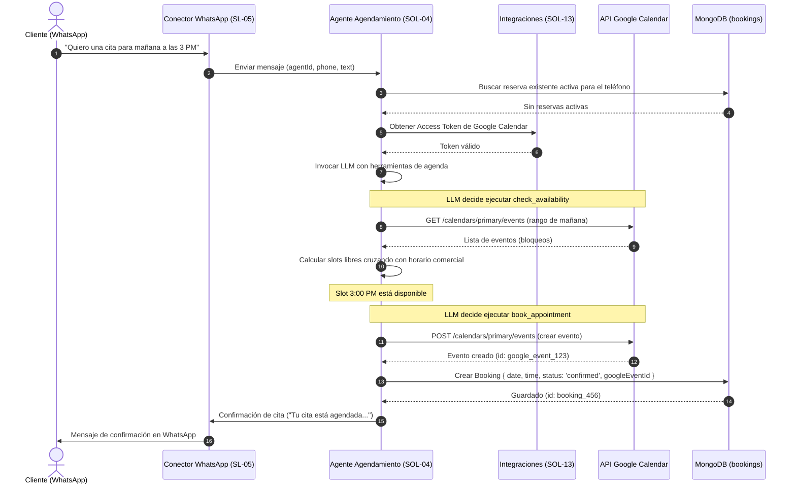

# Motor de Agente Agendamiento

## 1. Overview

### Contexto
El **Motor de Agente Agendamiento** (SOL-04) es una solución core de la iniciativa "Plataforma de Agentes Conversacionales". Permite que los agentes con tipo `agendamiento` entiendan y coordinen solicitudes de reserva de citas, verifiquen disponibilidad de horarios, registren nuevos eventos, envíen confirmaciones y gestionen cancelaciones o reprogramaciones, comunicándose con servicios de calendario externos.

### Relación con la iniciativa
Esta solución implementa las capacidades del core identificadas en la Fase 4:
- **Verificación de Disponibilidad**: Consulta de slots horarios libres para un día o rango de fechas específico.
- **Creación de Citas (Agendamiento)**: Registro físico de la cita en el calendario del comercio.
- **Recordatorios, Confirmaciones, Cancelaciones y Reprogramaciones**: Gestión del ciclo de vida completo de la reserva.
- **Integración con Canales**: Los clientes finales interactúan directamente mediante WhatsApp (SL-05) o paneles web integrados.

### Resumen ejecutivo técnico
El Agente de Agendamiento se basa en una arquitectura **híbrida** que combina **RAG (Retrieval-Augmented Generation)** y **Tool Calling (Function Calling)** a través de LangChain + Bedrock:
1. **RAG para Información Estática e Instrucciones**: El agente tiene acceso a la Base de Conocimientos del RAG. Si el usuario sube documentos (PDF, Word, Excel) indicando políticas de cancelación, precios, horarios generales de atención o reglas comerciales, esta información se recupera vectorialmente y se le provee al LLM como contexto.
2. **Tool Calling para Operaciones en Tiempo Real**: Para interactuar con la agenda de forma dinámica y evitar inconsistencias o "slots" duplicados, el LLM utiliza herramientas específicas (`check_availability`, `book_appointment`). Las llamadas a la API de Google Calendar y a la base de datos se ejecutan en tiempo real.

Las credenciales de acceso a Google Calendar se gestionan de manera segura mediante el módulo de Integraciones Externas (SOL-13).

### Dependencias

| Solución | Relación |
|----------|----------|
| [Gestión de Integraciones Externas](file:///home/st-t/Desktop/MultiBotsAgent/Documentacion/plataforma-agentes-conversacionales/solutions/SOL-13-gestion-integraciones-externas/README.md) | Proveedor — Administra las conexiones OAuth 2.0 y tokens de acceso para la API de Google Calendar. |
| [Conector de WhatsApp](file:///home/st-t/Desktop/MultiBotsAgent/Documentacion/plataforma-agentes-conversacionales/solutions/SL05-conector-whatsapp/conector-whatsapp.md) | Canal — Recibe los mensajes del cliente y envía las respuestas/confirmaciones del proceso de reserva. |
| [Gestión de Memoria Conversacional](file:///home/st-t/Desktop/MultiBotsAgent/Documentacion/plataforma-agentes-conversacionales/solutions/SOL-07-gestion-memoria-conversacional/gestion-memoria-conversacional.md) | Colaborador — Preserva el contexto de la reserva a lo largo de los turnos de diálogo (fecha elegida, datos del cliente, estado del flujo). |
| [Motor de Mensajes Proactivos](file:///home/st-t/Desktop/MultiBotsAgent/Documentacion/plataforma-agentes-conversacionales/solutions/SOL-09-motor-mensajes-proactivos/README.md) | Colaborador — Dispara recordatorios y notificaciones previas a la cita (ej. 24 horas antes) al número de WhatsApp del cliente. |
| [Panel de Administración Web](file:///home/st-t/Desktop/MultiBotsAgent/Documentacion/plataforma-agentes-conversacionales/solutions/SL01-panel-administracion-web/panel-administracion-web.md) | Consumidor — Permite a las empresas visualizar el listado de reservas confirmadas, configurar horarios de atención y configurar la vinculación al calendario. |

---

## 2. Solution Narrative

### 2.1 Consulta de Disponibilidad y Reserva Conversacional (Happy Path)

**Trigger:** Un cliente envía un mensaje por WhatsApp al bot diciendo: "Hola, me gustaría agendar una cita para mañana en la tarde".

**Comportamiento:**
1. El Conector de WhatsApp (que asocia el número telefónico a un único `agentId` específico) enruta el mensaje directamente al endpoint de procesamiento del agente (`/internal/agents/:agentId/process`).
2. El backend de NestJS (al recibir el `agentId` y validar su tipo en base de datos) identifica que es un agente de tipo `agendamiento` y delega la ejecución al motor de agendamiento en lugar del motor RAG convencional.
3. El motor del agente recupera la configuración de integración del agente (tokens de Google Calendar a través de SOL-13) y el historial de la conversación desde SOL-07.
4. Se invoca al LLM enviándole las herramientas (Tools) registradas para agendamiento: `check_availability` y `book_appointment`.
5. El LLM detecta la intención ("agendar cita") y la fecha relativa ("mañana en la tarde", calculada con base en el timestamp actual enviado en las directivas del sistema).
6. El LLM genera un Tool Call para `check_availability` con los parámetros: `{ date: "2026-06-03", range: "afternoon" }`.
7. El backend intercepta el Tool Call, realiza una llamada a la API de Google Calendar usando el token de la empresa (filtrando los eventos existentes en esa fecha) y cruza la información con el horario de atención configurado de la empresa.
8. El backend devuelve al LLM la lista de slots disponibles (ej. `["14:00", "15:00", "16:30"]`).
9. El LLM responde al cliente por WhatsApp: "Tengo los siguientes horarios libres para mañana por la tarde: 2:00 PM, 3:00 PM y 4:30 PM. ¿Cuál te queda mejor?".
10. El cliente responde: "El de las 3:00 PM está perfecto".
11. El LLM interpreta la selección y ejecuta `book_appointment` con los parámetros: `{ date: "2026-06-03", time: "15:00", durationMinutes: 60, customerName: "Juan Pérez", customerPhone: "+56912345678" }`.
12. El backend realiza la inserción del evento en Google Calendar y crea un registro correspondiente en la colección `bookings` en MongoDB con el estado `confirmed`.
13. El LLM confirma la reserva al usuario enviando los datos de la cita y el enlace de Google Calendar si corresponde.

**Resultado:** Cita reservada correctamente en Google Calendar y sincronizada localmente en la base de datos de la plataforma.

---

### 2.2 Cancelación o Reprogramación de Cita

**Trigger:** Un cliente envía un mensaje diciendo: "Hola, no podré asistir a mi cita de mañana a las 3 PM. ¿La podemos cambiar para el viernes a las 10 AM?".

**Comportamiento:**
1. El motor del agente recupera las citas activas del cliente buscando en la colección `bookings` por el número de teléfono del remitente.
2. Identifica la cita del 3 de junio de 2026 a las 15:00.
3. El LLM ejecuta la herramienta `check_availability` para el viernes propuesto ("2026-06-05") a las "10:00".
4. Si el slot está libre en Google Calendar:
   - El LLM ejecuta la herramienta `reschedule_appointment` pasando el `bookingId` de la reserva anterior, la nueva fecha y la nueva hora.
   - El backend modifica el evento existente en Google Calendar usando la API de actualización de eventos.
   - Se actualiza el documento en la colección `bookings` con los nuevos valores de fecha/hora e incrementa el contador de reprogramaciones.
   - El LLM confirma la reprogramación al cliente.
5. Si el slot está ocupado:
   - El LLM informa que no está disponible ese horario y ofrece las alternativas libres más cercanas.

**Resultado:** Cita reprogramada exitosamente en el calendario externo e interno.

---

### 2.3 Flujo de Secuencia



---

## 3. Out of Scope

- **Soporte Multi-Calendario Complejo**: No se soportará de forma nativa la asignación inteligente de citas rotando entre múltiples empleados (calendarios individuales) para el MVP. El agente interactuará únicamente con un (1) calendario de Google Calendar principal configurado por el agente.
- **Sincronización Total / Webhooks desde Google Calendar**: La plataforma no se suscribirá a webhooks de Google Calendar para recibir cambios hechos manualmente desde la app de Google Calendar en tiempo real. Toda la sincronización es bajo demanda cuando el usuario interactúa con el bot, o mediante validación en el momento de realizar transacciones.
- **Otros Proveedores de Calendario**: Outlook, Apple Calendar, Calendly, Cal.com o bases de datos locales no están soportados. La integración inicial es exclusivamente con Google Calendar.
- **Pasarelas de Pago**: El flujo de reserva no admite cobro de señas ni confirmación sujeta a pago en línea en esta fase.

---

## 4. Technical Context

### Patrones de arquitectura
- **Tool Calling (Function Calling)**: Uso de modelos LLM con capacidad nativa de selección de herramientas (ej. Claude 3 en Bedrock) para estructurar datos conversacionales en llamadas de funciones precisas.
- **Transactional Consistency**: Las acciones que impactan a Google Calendar y a la base de datos local se realizan secuencialmente. En caso de fallar la API de Google Calendar, no se persiste la reserva localmente para evitar inconsistencias.
- **Abstraction Layer (Provider)**: Las llamadas a Google Calendar se encapsulan en un proveedor dedicado en la capa de servicios de integraciones, ocultando la complejidad del protocolo HTTP de Meta/Google.

### Alineación con el Flujo del Motor RAG
Para garantizar un comportamiento consistente y predecible, el ciclo de vida de procesamiento de consultas del **Motor de Agente Agendamiento** se alinea directamente con los pasos del `RagEngineService` existente, operando bajo un modelo híbrido (RAG + Tools):

| Paso del Flujo | Comportamiento en Motor RAG | Equivalente en Motor de Agendamiento |
|---|---|---|
| **1. Validación de Entrada** | Rechaza mensajes vacíos o nulos. | Mismo comportamiento: valida datos de entrada antes del procesamiento. |
| **2. Configuración del Agente** | Recupera la configuración (`AgentConfig`) de la base de datos. | Recupera la configuración e inyecta la conexión de Google Calendar (SOL-13). |
| **3. Control de Escalamiento Humano** | Si la conversación ya está escalada (`status: 'escalated'`), guarda el mensaje en logs y omite el procesamiento. | Mismo comportamiento: si hay una conversación escalada activa, no interfiere y omite el agendador. |
| **4. Historial y Sesión** | Recupera el historial conversacional (`MemoryService`) y verifica si es una sesión nueva. | Mismo comportamiento: recupera contexto y prepara la inyección del mensaje de bienvenida. |
| **5. Consulta de Datos** | Realiza búsqueda vectorial en la Base de Conocimiento. | **Consulta Dual**: Realiza la búsqueda vectorial en la base de conocimientos (RAG) para obtener políticas/reglas generales y consulta localmente en la base de datos las citas activas del cliente (`bookings`). |
| **6. Filtro de Intención y Palabras Clave** | Detecta palabras clave de escalamiento explícito antes del LLM para transferir de inmediato. | Mismo comportamiento: palabras de transferencia directa ("hablar con humano", "operador") gatillan el escalamiento automático. |
| **7. Construcción del Prompt** | Genera System Prompt con fragmentos RAG y variables. | Genera System Prompt agregando: (a) Fragmentos RAG relevantes sobre políticas de la empresa, (b) Estado de citas actuales del cliente, (c) Fecha/hora actual del sistema, y (d) Especificación de herramientas (Tools). |
| **8. Invocación y Control del LLM** | Envía el prompt y maneja palabras clave de salida del LLM (`TRANSFER` o `NO_INFO`). | Envía el prompt con herramientas. El LLM decide si responder usando el contexto (RAG) o si invoca una herramienta (Tool) para disponibilidad o agendamiento. El backend ejecuta la herramienta en tiempo real contra Google Calendar y retroalimenta al modelo. Maneja `TRANSFER` del LLM. |
| **9. Persistencia y Formateo** | Guarda la interacción en memoria e inyecta el `welcomeMessage` si corresponde. | Mismo comportamiento: persiste los mensajes en la memoria de chat, e inyecta el mensaje de bienvenida al inicio de la sesión. |

### Stack técnico
- **Google Calendar API**: Integración REST utilizando las librerías oficiales de Google (`googleapis`) o cliente HTTP adaptado para SST Secrets.
- **Base de Datos**: MongoDB (colección `bookings` gestionada por `@multibotagents/db`).
- **Orquestación**: NestJS en `apps/services/api-multi-bots` (módulo de agentes y nuevo módulo de agendamiento/citas).
- **IA**: LangChain JS/TS para la gestión de herramientas y prompts estructurados.

---

### Modelo de datos conceptual

Se creará una nueva colección `bookings` en MongoDB para registrar y gestionar el histórico de citas y el estado de la integración local.

#### Esquema de MongoDB (`booking.schema.ts`):
```typescript
import { ObjectId } from "mongodb";

export interface BookingDocument {
  _id: ObjectId;
  companyId: ObjectId;
  agentId: ObjectId;
  googleEventId: string; // ID de evento retornado por Google Calendar
  customerName: string;
  customerPhone: string;
  customerEmail?: string;
  dateTime: Date;        // Fecha y hora de inicio UTC
  durationMinutes: number;
  status: "confirmed" | "cancelled" | "rescheduled";
  notes?: string;
  rescheduleCount: number;
  createdAt: Date;
  updatedAt: Date;
}
```

---

### Contratos de integración

#### Definición de Herramientas del LLM (Tool Specs en `packages/core`):

```typescript
export const CHECK_AVAILABILITY_TOOL = {
  name: "check_availability",
  description: "Verifica los horarios (slots) disponibles para una fecha específica o rango de fechas.",
  input_schema: {
    type: "object",
    properties: {
      date: {
        type: "string",
        description: "Fecha en formato ISO 8601 YYYY-MM-DD del día a consultar."
      },
      timeOfDay: {
        type: "string",
        enum: ["morning", "afternoon", "any"],
        description: "Preferencia de jornada de disponibilidad."
      }
    },
    required: ["date"]
  }
};

export const BOOK_APPOINTMENT_TOOL = {
  name: "book_appointment",
  description: "Registra una cita confirmada en el calendario tras la aceptación del cliente.",
  input_schema: {
    type: "object",
    properties: {
      date: {
        type: "string",
        description: "Fecha elegida (YYYY-MM-DD)."
      },
      time: {
        type: "string",
        description: "Hora elegida en formato 24h (HH:MM)."
      },
      customerName: {
        type: "string",
        description: "Nombre completo del cliente proporcionado en el chat."
      },
      durationMinutes: {
        type: "number",
        default: 60,
        description: "Duración de la cita en minutos."
      }
    },
    required: ["date", "time", "customerName"]
  }
};
```

#### Especificación de API REST (Swagger/OpenAPI):

El módulo `bookings` expone un conjunto de endpoints REST protegidos bajo el tag **Bookings** en Swagger, requiriendo autenticación por token JWT Bearer (`access-token`) y control de acceso limitado por `companyId`.

*   **GET `/bookings` (Listar y filtrar reservas)**
    *   *Descripción*: Recupera las citas agendadas de la empresa asociada al usuario autenticado.
    *   *Parámetros de consulta (Query)*:
        *   `agentId` (string, opcional, MongoId): Filtrar por ID del agente.
        *   `customerPhone` (string, opcional): Filtrar por teléfono del cliente.
        *   `status` (enum: `'confirmed' \| 'cancelled' \| 'rescheduled'`, opcional): Filtrar por estado.
        *   `startDate` (string, opcional, ISO Date): Inicio de rango de fecha de reserva.
        *   `endDate` (string, opcional, ISO Date): Fin de rango de fecha de reserva.
    *   *Respuestas*:
        *   `200`: Array de objetos `Booking` recuperados con éxito.
        *   `401`: Token JWT no proporcionado o inválido.
        *   `403`: El agente solicitado pertenece a otra empresa o permisos insuficientes.
        *   `500`: Error interno del servidor.

*   **GET `/bookings/:id` (Detalles de una reserva)**
    *   *Descripción*: Obtiene la información detallada de una cita por su ID.
    *   *Parámetros de ruta*:
        *   `id` (string, requerido): ID único de MongoDB de la reserva.
    *   *Respuestas*:
        *   `200`: Detalle del objeto `Booking`.
        *   `401`: Token JWT inválido.
        *   `403`: La reserva solicitada pertenece a otra empresa.
        *   `404`: Reserva no encontrada.

*   **POST `/bookings` (Crear reserva manual)**
    *   *Descripción*: Permite al operador registrar una nueva cita de manera manual desde el panel de control.
    *   *Cuerpo (JSON)*:
        *   `agentId` (string, requerido, MongoId): ID del agente de agendamiento.
        *   `customerName` (string, requerido): Nombre del cliente.
        *   `customerPhone` (string, requerido): Teléfono de WhatsApp del cliente.
        *   `customerEmail` (string, opcional): Correo electrónico.
        *   `dateTime` (string, requerido, ISO Date): Fecha y hora de inicio de la cita.
        *   `durationMinutes` (number, opcional, default 30): Duración en minutos.
        *   `notes` (string, opcional): Observaciones adicionales.
    *   *Respuestas*:
        *   `201`: Reserva creada y guardada con éxito (incluye `googleEventId`).
        *   `400`: Payload inválido o agente no es del tipo agendamiento.
        *   `403`: El agente solicitado pertenece a otra empresa.
        *   `404`: Agente no encontrado.

*   **PATCH `/bookings/:id` (Actualizar o reprogramar)**
    *   *Descripción*: Modifica la información o reprograma el horario de una cita. Si `dateTime` cambia, se autoincrementa `rescheduleCount` y cambia el estado a `'rescheduled'`.
    *   *Parámetros de ruta*:
        *   `id` (string, requerido): ID único de MongoDB de la reserva.
    *   *Cuerpo (JSON)*: Campos parciales editables (`customerName`, `customerPhone`, `customerEmail`, `dateTime`, `durationMinutes`, `status`, `notes`).
    *   *Respuestas*:
        *   `200`: Reserva actualizada y sincronizada exitosamente.
        *   `400`: Formato de fecha erróneo o payload inválido.
        *   `403`: La reserva pertenece a otra empresa.
        *   `404`: Reserva no encontrada.

*   **DELETE `/bookings/:id` (Cancelar reserva)**
    *   *Descripción*: Realiza la cancelación lógica de una reserva actualizando su estado a `'cancelled'`.
    *   *Parámetros de ruta*:
        *   `id` (string, requerido): ID único de MongoDB de la reserva.
    *   *Respuestas*:
        *   `200`: Reserva marcada como cancelada.
        *   `401`: Token JWT inválido.
        *   `403`: La reserva pertenece a otra empresa.
        *   `404`: Reserva no encontrada.

---

## 5. Acceptance Criteria

### Capa de Datos (packages/db)
- [x] Creado el archivo `booking.schema.ts` y exportado en el barrel file correspondiente.
- [x] Implementado `BookingRepository` que permita realizar las operaciones CRUD sobre la colección `bookings` (búsqueda por número de teléfono, rango de fechas y estados).
- [x] Definido JSON Schema de validación de MongoDB para asegurar que cada cita contenga `googleEventId` y la referencia correcta a `agentId` y `companyId`.

### Capa de Backend (apps/services/api-multi-bots)
- [x] Creado el módulo `bookings` en NestJS para exponer la visualización y gestión manual de reservas.
- [ ] Implementado el proveedor de Google Calendar que consuma los tokens OAuth del módulo de Integraciones para crear, actualizar y borrar eventos.
- [ ] Implementadas las clases de orquestación en `packages/core` que actúan como "Tools" en el flujo del LLM (Bedrock).
- [ ] Los flujos de error (ej. token de Google Calendar expirado) son interceptados correctamente, devolviendo un mensaje amigable al cliente e informando al comercio de la necesidad de re-autenticar.

### Capa de Frontend (apps/web)
- [ ] En la pestaña de detalle de agentes de agendamiento, se muestra la configuración del horario de atención comercial (días, horas de inicio y fin) y el estado de conexión con Google Calendar.
- [ ] Implementada una vista de calendario o listado interactivo en el dashboard para que la empresa pueda visualizar, buscar y filtrar las citas concretadas por el bot.

---

## 6. MVP vs Solución Completa

### MVP (Fase 4)
- Integración directa con una única cuenta de Google Calendar vinculada al agente.
- Parametrización estática de días hábiles y horarios permitidos en la base de datos.
- Registro básico del nombre y teléfono del cliente capturados de WhatsApp.

### Solución Completa (Post-MVP)
- Asignación inteligente tipo Round-Robin para distribuir citas entre múltiples calendarios (empleados).
- Gestión avanzada de zonas horarias para citas internacionales.
- Soporte para reprogramación interactiva con enlaces dinámicos de autogestión.
- Envío automatizado de encuestas de satisfacción tras la finalización de la cita en integración con la bandeja de entrada (SL-08).

---

## 7. Risks & Assumptions

### Supuestos
- La empresa cuenta con una cuenta activa de Google Suite / Google Calendar y ha realizado satisfactoriamente el flujo de conexión en la sección de integraciones (SOL-13).
- El número de WhatsApp del cliente es un identificador confiable para rastrear reservas existentes en la sesión activa.

### Riesgos y Mitigaciones
- **Riesgo 1 (Expiración o Revocación de Tokens OAuth)**: El token de acceso a Google Calendar expira o se invalida silenciosamente, impidiendo registrar citas reales en la agenda del comercio mientras el bot sigue guardando y confirmando localmente en MongoDB.
  - *Mitigación*: Implementar un cron job diario que valide la salud del token de todos los agentes. Si falla la renovación del token de Google, se cambia preventivamente el estado del agente a `disconnected` en MongoDB, deshabilitando de inmediato la agenda del bot en el chat (escalando a humano) y enviando una alerta al dashboard de administración de la empresa para re-autenticar la cuenta.
- **Riesgo 2 (Desincronización por cambios manuales / Overbooking)**: El comercio modifica o añade un evento directamente en su app de Google Calendar. Al no tener webhooks activos en el MVP, se puede producir una colisión de horarios si el bot agenda sobre este slot.
  - *Mitigación*: Justo antes de ejecutar el Tool Call de confirmación de reserva (`book_appointment`), el backend realiza una consulta "fresh" en tiempo real contra Google Calendar de ese bloque específico de tiempo para validar que no haya colisiones de último segundo.
- **Riesgo 3 (Límites de Cuota de Google API / Rate Limits 429)**: Las múltiples consultas consecutivas de slots libres saturarían las llamadas directas a la API de Google, provocando bloqueos y alucinaciones en el LLM.
  - *Mitigación*: Almacenar la disponibilidad en una caché temporal (TTL de 2 minutos) persistida en **MongoDB** en un campo de la configuración del agente (o una colección intermedia indexada con borrado automático TTL), evitando consultas redundantes a Google Cloud y prescindiendo de dependencias adicionales como Redis.
- **Riesgo 4 (Desajustes de Zona Horaria)**: Diferencias horarias entre el huso del cliente y el servidor de AWS provocan citas desplazadas en Google Calendar.
  - *Mitigación*: Declarar de manera obligatoria la propiedad `timezone` (IANA) por agente. Toda conversión y validación se realiza localizadamente respecto a la zona horaria comercial, persistiendo en UTC de forma estandarizada.
- **Riesgo 5 (Alucinaciones de fecha en lenguaje natural por parte del LLM)**: El LLM puede interpretar mal expresiones relativas y confirmar citas en días u horas erróneos.
  - *Mitigación*: Forzar un flujo conversacional de confirmación en dos pasos. El bot detalla explícitamente el día y la hora formateados numéricamente y solicita aprobación activa del cliente antes de llamar a la herramienta de agendamiento. Además, se inyecta el día actual y una lista de los próximos 7 días naturales como contexto en el System Prompt.
