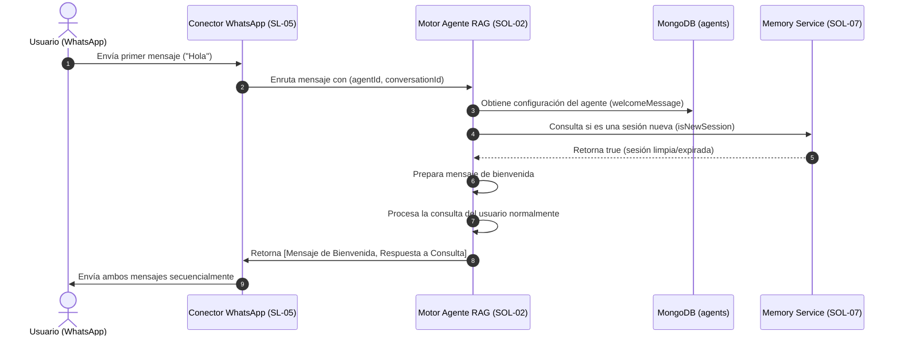

# Motor de Personalidad del Agente

## 1. Overview

### Contexto
El **Motor de Personalidad del Agente** (SOL-11) es una solución transversal de la iniciativa "Plataforma de Agentes Conversacionales". Provee la estructura y el comportamiento para definir la identidad (nombre), el estilo comunicacional (tono, idioma), los límites de comportamiento (restricciones) y el primer contacto (mensaje de bienvenida) de todos los tipos de agentes (RAG, Cotizador, Agendamiento) disponibles en la plataforma.

### Relación con la iniciativa
Esta solución implementa las capacidades transversales identificadas en la Fase 2:
- **Configuración de Personalidad**: Permite definir y actualizar de manera dinámica cómo responde el agente y bajo qué reglas de negocio opera.
- **Mensaje de Bienvenida**: Establece el saludo inicial proactivo enviado de forma automática al usuario al inicio de una sesión limpia.
- **Transversalidad**: Aplica uniformemente a cualquier tipo de agente, sirviendo como una de las entradas de configuración críticas para la generación del System Prompt en los LLM.

### Resumen ejecutivo técnico
Se diseñará una estructura de datos integrada en la entidad `Agent` (colección `agents` de MongoDB) que encapsule los parámetros cognitivos y de identidad. 

Se implementará un servicio de gestión y endpoints en NestJS (`api-multi-bots`) para su persistencia, junto con una interfaz gráfica completa y premium en Next.js en la pestaña "Personalidad" del detalle del agente. La configuración resultante es consumida directamente por la función `buildSystemPrompt` de `packages/core` para alterar en caliente el comportamiento conversacional del modelo.

### Dependencias

| Solución | Relación |
|----------|----------|
| [Panel de Administración Web](file:///home/st-t/Desktop/MultiBotsAgent/Documentacion/plataforma-agentes-conversacionales/solutions/SL01-panel-administracion-web/panel-administracion-web.md) | Consumidor — Interfaz gráfica que permite editar los campos de personalidad del agente. |
| [Motor de Agente RAG](file:///home/st-t/Desktop/MultiBotsAgent/Documentacion/plataforma-agentes-conversacionales/solutions/SOL-02-motor-agente-rag/motor-agente-rag.md) | Consumidor — Extrae los parámetros de personalidad para compilar el System Prompt y enviar el mensaje de bienvenida. |
| [Gestión de Memoria Conversacional](file:///home/st-t/Desktop/MultiBotsAgent/Documentacion/plataforma-agentes-conversacionales/solutions/SOL-07-gestion-memoria-conversacional/gestion-memoria-conversacional.md) | Colaborador — Determina si una interacción corresponde a un inicio de sesión limpia para disparar el mensaje de bienvenida. |
| [Gestión de Empresas y Acceso](file:///home/st-t/Desktop/MultiBotsAgent/Documentacion/plataforma-agentes-conversacionales/solutions/SL14-gestion-empresas-acceso/README.md) | Propietario — Define y expone el ciclo de vida y CRUD básico de la entidad `Agent`. |

---

## 2. Solution Narrative

### 2.1 Configuración de Personalidad desde el Panel Web (Happy Path)

**Trigger:** Un usuario administrador en el panel web navega al detalle de un agente y selecciona la pestaña "Personalidad".

**Comportamiento:**
1. El frontend realiza una petición HTTP `GET /api/agents/:id` para recuperar la configuración del agente.
2. El componente carga los datos en un formulario interactivo con campos específicos:
   - **Nombre en Chat**: Nombre público con el que se identificará el agente.
   - **Tono de Voz**: Menú desplegable con preajustes curados (ej: profesional, amigable, humorístico, asertivo).
   - **Idioma**: Selector del idioma de salida predeterminado para las interacciones.
   - **Mensaje de Bienvenida**: Caja de texto para el saludo automático.
   - **Instrucciones Generales**: Directrices de comportamiento base.
   - **Restricciones de Negocio**: Listado dinámico de etiquetas (chips) con reglas que no debe romper (ej: "No hablar de la competencia", "No prometer descuentos").
3. El usuario realiza modificaciones y hace clic en "Guardar cambios".
4. El frontend valida la integridad de los datos localmente y envía una petición HTTP `PATCH /api/agents/:id` con la estructura correspondiente.
5. El backend NestJS recibe y valida el DTO utilizando `class-validator`, guardándolo en la colección `agents` mediante el repositorio MongoDB correspondiente.
6. Se actualiza el documento de manera atómica y se devuelve la configuración actualizada al cliente.

**Resultado:** Cambios de personalidad persistidos. Las siguientes conversaciones iniciadas o en curso con el agente reflejarán la nueva personalidad de inmediato debido a que el motor carga la configuración en caliente por cada consulta.

---

### 2.2 Inyección de Personalidad y Construcción de System Prompt

**Trigger:** Llega un mensaje del usuario al motor del agente (ej. RAG).

**Comportamiento:**
1. El motor del agente recupera la configuración actual del agente desde la base de datos (con su sección `personality`).
2. Se invoca a `buildSystemPrompt(config.personality, config.language)` en `packages/core/src/rag-engine/prompt-building.ts`.
3. Esta función genera un bloque estructurado de instrucciones que incluye:
   - Identificación del rol (`Eres {name}`).
   - Directriz de tono (`Tu tono es {tone}`).
   - Un bloque numerado de restricciones explícitas derivadas del array `restrictions`.
   - Instrucciones directas de comportamiento de `instructions`.
4. El System Prompt generado se combina con las instrucciones críticas del sistema (tales como no alucinar, instrucciones de escalamiento y el formato conversacional de WhatsApp).
5. Se envía el prompt concatenado al LLM (vía Bedrock) junto con el historial y el contexto de conocimiento.

**Resultado:** El LLM genera una respuesta que se adapta estrictamente al rol, tono e idioma deseados, respetando las restricciones del negocio.

---

### 2.3 Disparo del Mensaje de Bienvenida en Sesiones Nuevas



---

## 3. Out of Scope

- **Traducción en tiempo real de prompts**: El sistema no traduce de forma dinámica el prompt base si el idioma cambia. El prompt final se construye en el idioma en que se escribieron las restricciones e instrucciones, limitándose a inyectar la regla `"Idioma de respuesta: {language}"`.
- **Generación de avatares sintéticos**: Esta solución maneja únicamente la personalidad textual y comportamiento semántico. La generación de imágenes, fotos de perfil o avatares de IA queda fuera del alcance de este módulo.
- **Plantillas complejas de prompt editor (Raw Editor)**: El usuario no puede modificar el esqueleto del System Prompt del sistema (como los tokens críticos de control `TRANSFER` o `NO_INFO`). Solo puede proveer los campos parametrizables definidos en esta solución.

---

## 4. Technical Context

### Patrones de arquitectura
- **Data Transfer Object (DTO)**: Estructuras estrictas para la validación de entrada en la API NestJS mediante decoradores (`class-validator` y `class-transformer`).
- **Dynamic Configuration Injection**: La configuración cognitiva del agente se consulta en caliente en cada interacción conversacional en vez de cachearse indefinidamente, permitiendo la actualización de personalidad en tiempo real y sin necesidad de reinicio de servicios.
- **Aislamiento de Módulos (Screaming Architecture)**: Toda la UI de Personalidad reside dentro del dominio de negocio `features/agentes/components/` en el frontend, mientras que la base de datos interactúa a través de los adaptadores tipados.

### Stack técnico
- **Base de Datos**: MongoDB Atlas (colección `agents`).
- **Backend API**: NestJS (TypeScript 5.x, `@nestjs/common`, `class-validator`, `mongodb`).
- **Frontend**: Next.js 14 (React 18, Tailwind CSS, Lucide React para iconografía).

---

### Modelo de datos conceptual

Se formalizará la definición del esquema para la colección `agents` dentro de `packages/db`. Este esquema incluirá las reglas de validación estructuradas mediante JSON Schema de MongoDB para asegurar que los tipos guardados correspondan fielmente a las interfaces compartidas de la plataforma.

#### Esquema de MongoDB (`agents.schema.ts`):
```typescript
export interface AgentDocument {
  _id: ObjectId;
  companyId: ObjectId;
  nombre: string;
  tipo: "rag" | "cotizador" | "agendamiento";
  estado: "activo" | "borrador";
  instrucciones?: string; // Fallback antiguo
  relevanceThreshold: number;
  topK: number;
  maxResponseLength: number;
  memoryWindow: number;
  welcomeMessage?: string;
  noInfoMessage: string;
  errorMessage: string;
  language: string;
  personality: {
    name: string;
    tone: string;
    restrictions: string[];
    instructions: string;
  };
  createdAt: Date;
  updatedAt: Date;
}
```

#### Regla de Validación JSON Schema de MongoDB:
```json
{
  "$jsonSchema": {
    "bsonType": "object",
    "required": ["companyId", "nombre", "tipo", "estado", "relevanceThreshold", "topK", "maxResponseLength", "memoryWindow", "language", "personality", "createdAt", "updatedAt"],
    "properties": {
      "companyId": { "bsonType": "objectId" },
      "nombre": { "bsonType": "string", "minLength": 1 },
      "tipo": { "bsonType": "string", "enum": ["rag", "cotizador", "agendamiento"] },
      "estado": { "bsonType": "string", "enum": ["activo", "borrador"] },
      "welcomeMessage": { "bsonType": "string" },
      "language": { "bsonType": "string" },
      "personality": {
        "bsonType": "object",
        "required": ["name", "tone", "restrictions", "instructions"],
        "properties": {
          "name": { "bsonType": "string", "minLength": 1 },
          "tone": { "bsonType": "string" },
          "restrictions": {
            "bsonType": "array",
            "items": { "bsonType": "string" }
          },
          "instructions": { "bsonType": "string" }
        }
      }
    }
  }
}
```

---

### Contratos de integración

#### Endpoints API (NestJS)

- **GET `/api/agents/:id`**
  - **Descripción**: Obtiene la configuración de un agente.
  - **Respuesta (200 OK)**:
    ```json
    {
      "id": "6a17081684826f9c174d2118",
      "companyId": "507f1f77bcf86cd799439010",
      "nombre": "Agente Soporte",
      "tipo": "rag",
      "estado": "activo",
      "language": "es",
      "welcomeMessage": "¡Hola! ¿En qué puedo ayudarte?",
      "personality": {
        "name": "Sofía",
        "tone": "profesional",
        "restrictions": [
          "No hablar de la competencia",
          "No prometer devoluciones de dinero directamente"
        ],
        "instructions": "Eres una experta en soporte técnico de la plataforma. Guía al usuario paso a paso."
      }
    }
    ```

- **PATCH `/api/agents/:id`**
  - **Descripción**: Actualiza campos específicos del agente. Permite actualización parcial (patch).
  - **Cuerpo de la Petición (Request Body)**:
    ```typescript
    export class UpdateAgentDto {
      @IsOptional()
      @IsString()
      nombre?: string;

      @IsOptional()
      @IsString()
      language?: string;

      @IsOptional()
      @IsString()
      welcomeMessage?: string;

      @IsOptional()
      @ValidateNested()
      @Type(() => PersonalityConfigDto)
      personality?: PersonalityConfigDto;
    }
    ```

---

## 5. Acceptance Criteria

### Capa de Datos (packages/db)
- [ ] Definido el esquema `agents.schema.ts` y exportado correctamente en el barrel file de esquemas.
- [ ] Creada la validación JSON Schema para MongoDB que impone el objeto `personality` obligatorio con los campos internos: `name`, `tone`, `restrictions` (array de strings) e `instructions`.
- [ ] Creado un script de migración para aplicar el esquema a la colección `agents`.

### Capa de Backend (apps/services/api-multi-bots)
- [ ] Implementado el módulo `agents` con su correspondiente `AgentsController` y `AgentsService`.
- [ ] Los endpoints `GET /api/agents/:id` y `PATCH /api/agents/:id` permiten consultar y modificar la personalidad del agente de manera segura (validando que el agente pertenezca a la compañía asociada al token JWT).
- [ ] `MongoAgentConfigProvider` está totalmente adaptado para mapear los campos estructurados de la base de datos a `AgentConfig` sin errores de tipado.
- [ ] El constructor de prompts `buildSystemPrompt` utiliza la personalidad estructurada para inyectar correctamente el nombre, tono, restricciones y directrices en el LLM.

### Capa de Frontend (apps/web)
- [ ] La pestaña "Personalidad" en `agente-detalle-tabs.tsx` ya no es un mockup y renderiza el formulario dinámico.
- [ ] El usuario puede agregar y eliminar restricciones usando componentes interactivos (ej. chips o lista interactiva de inputs).
- [ ] El formulario valida localmente:
  - Nombre del agente requerido.
  - Mensaje de bienvenida menor a 500 caracteres.
  - Idioma seleccionado del dropdown de opciones válidas.
- [ ] Al presionar "Guardar cambios", se realiza una llamada HTTP real al endpoint `PATCH /api/agents/:id`.
- [ ] Se muestra indicador visual de carga (loading spinner) en el botón y feedback de éxito ("Cambios guardados") o error ("Error al guardar la personalidad") de forma clara.

---

## 6. MVP vs Solución Completa

### MVP (Fase 1)
- Selección de tonos limitada a 4 opciones estáticas: `Profesional`, `Amigable`, `Empático`, `Técnico`.
- Idiomas soportados estáticos: Español (`es`), Inglés (`en`), Portugués (`pt`).
- Restricciones como lista lineal de strings.
- Mensaje de bienvenida de solo texto sin formato.

### Solución Completa (Post-MVP)
- Tono personalizable mediante instrucciones descriptivas libres ("Custom Tone").
- Mensaje de bienvenida multimedia (soporte para imágenes, videos de introducción o botones de respuesta rápida de WhatsApp).
- Integración de plantillas cognitivas pre-configuradas según el rubro de la empresa (ej: "Plantilla Inmobiliaria", "Plantilla E-Commerce").
- Asistente de IA en el panel web para sugerir y auto-redactar el mensaje de bienvenida y restricciones basadas en la descripción de la empresa.

---

## 7. Risks & Assumptions

### Supuestos
- Se asume que el backend inyectará el `companyId` del usuario autenticado en la request para evitar que se puedan modificar agentes de otras organizaciones.
- Se asume que el LLM tiene la capacidad cognitiva para comprender e internalizar las restricciones inyectadas en formato de lista dentro del System Prompt sin violarlas (los benchmarks iniciales con Claude 3 Haiku y Bedrock demuestran alta adherencia).

### Riesgos y Mitigaciones
- **Riesgo 1 (Violación de Restricciones)**: El LLM podría ignorar las restricciones si el prompt del usuario es agresivo (Prompt Injection).
  - *Mitigación*: En `buildSystemPrompt`, el bloque de instrucciones críticas (`<instrucciones_criticas>`) se sitúa deliberadamente al final del System Prompt, dándole máxima prioridad de atención semántica al procesar la respuesta.
- **Riesgo 2 (Inconsistencia de Datos Históricos)**: Agentes antiguos en la base de datos que no tengan el objeto `personality` definido podrían fallar al cargarse.
  - *Mitigación*: Implementar lógica de fallback robusta en `MongoAgentConfigProvider` y en la base de datos (por ejemplo, poblar el objeto `personality` por defecto durante la migración o mediante defaults dinámicos en el código).
