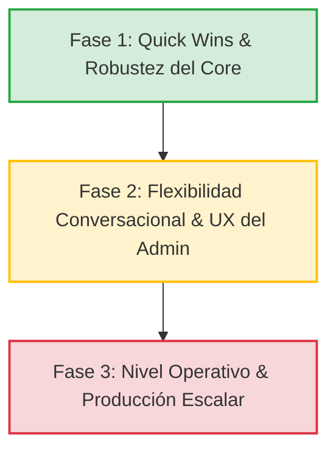

# Propuestas de Mejora Técnica para MultiBotAgents

Este documento toma como base la **Fase 3: Solution Map Preliminar** de la [iniciativa de plataforma de agentes conversacionales](file:///c:/Users/Jessy/.gemini/antigravity-ide/scratch/MultiBotsAgent/Documentacion/plataforma-agentes-conversacionales/plataforma-agentes-conversacionales-iniciativa.md) y propone mejoras concretas para cada solución, alineadas con la arquitectura existente del monorepo (TypeScript strict, NestJS en Fargate, Next.js App Router, MongoDB Atlas, Lambdas nativas, SST v3) y el propósito original del proyecto: una plataforma plug & play para que empresas activen agentes de IA especializados sobre canales de mensajería masiva.

---

## Soluciones Core

---

### Solución 1: Panel de Administración Web

**Mejora: Playground de Pruebas con Trazado de Ejecución**

Agregar una pestaña de **Playground** en la vista de detalle de cada agente dentro del panel web (`apps/web/src/features/agentes/`). Esta pestaña contendría:

- **Chat de prueba en vivo**: El administrador puede enviar mensajes al agente sin necesidad de usar WhatsApp, validando el comportamiento antes de poner el bot en producción.
- **Panel de trazado lateral**: Mientras el chat de prueba responde, un visor lateral muestra el desglose técnico de cada respuesta:
  1. **System Prompt compilado**: Las instrucciones, tono, restricciones e idioma que se inyectaron al LLM.
  2. **Fragmentos RAG recuperados**: Qué fragmentos de la base de conocimiento se encontraron, con su score de similitud y cuáles fueron descartados por el threshold.
  3. **Tokens y latencia**: Consumo de tokens de entrada/salida y latencia exacta en milisegundos.

**¿Por qué?**: Actualmente, si un bot responde mal en WhatsApp, el administrador no tiene forma de saber *por qué*. Esta herramienta convierte al panel de una interfaz de configuración a una **herramienta de ingeniería de agentes**, diferenciando la plataforma de cualquier chatbot builder genérico.

**Dónde encaja en la arquitectura**: Se agregaría un nuevo endpoint `POST /agents/:id/test` en el servicio NestJS (`apps/services/api-multi-bots`) que ejecuta el motor RAG y retorna la respuesta junto con los metadatos de la traza. El frontend consume este endpoint desde un nuevo componente `agente-tab-playground.tsx` siguiendo la estructura de Screaming Architecture existente.

---

### Solución 2: Motor de Agente RAG

**Mejora A: Memoria de Trabajo Sintetizada (Working Memory)**

En lugar de alimentar al LLM únicamente con una ventana plana de mensajes anteriores, implementar un paso de **síntesis de contexto** en `@multibotagents/core`. Cada N turnos de conversación, un micro-prompt resume los hechos clave mencionados por el usuario (ej: *"El cliente se llama Carlos, preguntó por audífonos Bluetooth y su presupuesto es de $50.000"*). Esta síntesis compacta se inyecta en el system prompt del agente en lugar del historial completo.

**¿Por qué?**: El historial conversacional plano consume ventana de contexto de forma lineal. A medida que la conversación avanza, los primeros mensajes se pierden o se recortan. La síntesis de hechos garantiza que la información relevante persista sin importar la longitud de la conversación, y reduce el consumo de tokens por turno.

**Mejora B: Re-escritura de Queries Multi-Turno**

Cuando el usuario escribe una pregunta de seguimiento corta (ej: *"¿Cuánto cuesta?"*), la búsqueda semántica contra la base de datos vectorial puede fallar porque la query aislada no tiene contexto. Implementar un pre-procesador en `packages/core/src/rag-engine/` que utilice los últimos 2-3 mensajes del historial para re-escribir la consulta antes de buscar (ej: *"¿Cuánto cuestan los audífonos Bluetooth?"*).

**¿Por qué?**: Mejora directamente la tasa de éxito de respuestas del agente RAG, que es la métrica más importante del producto. Sin esta mejora, las preguntas de seguimiento (que son la mayoría en conversaciones naturales) producen fragmentos irrelevantes o vacíos.

---

### Solución 3: Motor de Agente Cotizador

**Mejora: Acciones del Catálogo como Herramientas Declarativas (Function Calling)**

En lugar de codificar el flujo del cotizador como una secuencia procedural rígida en el servicio NestJS, definir las acciones atómicas del catálogo como herramientas declarativas que el LLM puede invocar por sí mismo:

- `buscar_productos(categoría, rango_precio)` → Retorna lista filtrada del catálogo.
- `crear_cotización(items, datos_cliente)` → Arma la cotización con subtotales.
- `confirmar_pedido(cotización_id)` → Persiste el pedido en MongoDB y emite la notificación.

Cada herramienta se define con un esquema Zod en `@multibotagents/core` y se expone al LLM mediante *function calling*, permitiéndole decidir cuándo y en qué orden ejecutar cada acción según la intención del cliente.

**¿Por qué?**: La conversación natural de un cliente no sigue un flujo lineal. Un cliente puede preguntar por precios, agregar un producto, volver a preguntar por otro y finalmente confirmar. Un motor procedural necesita manejar todas las combinaciones posibles; un agente con herramientas declarativas resuelve el flujo de forma orgánica. Además, esto prepara la base para el **agente híbrido futuro** (un bot que responda preguntas RAG *y* cotice si el cliente lo solicita).

---

### Solución 4: Motor de Agente Agendamiento

**Mejora A: Bloqueo Temporal Optimista de Slots**

Al momento en que el cliente selecciona un horario, crear un registro temporal de bloqueo en MongoDB (TTL de 5 minutos) para ese slot. Si el cliente confirma, el bloqueo se convierte en reserva permanente en Google Calendar. Si no confirma, el TTL de MongoDB libera el slot automáticamente.

**¿Por qué?**: Dos clientes de la misma empresa podrían estar agendando citas simultáneamente en WhatsApp. Sin un mecanismo de bloqueo temporal, ambos podrían recibir confirmación para el mismo horario (double-booking). Este patrón optimista es liviano, no requiere locks distribuidos y aprovecha la funcionalidad nativa de TTL indexes de MongoDB.

**Mejora B: Abstracción del Servicio de Calendario**

Encapsular la API de Google Calendar detrás de una interfaz `ICalendarService` en `@multibotagents/core`, siguiendo el patrón adaptador que ya usa `@multibotagents/db`. El token OAuth2 se inyecta por constructor. El agente interactúa exclusivamente con el puerto abstracto.

**¿Por qué?**: La iniciativa define explícitamente que la integración con calendarios distintos a Google Calendar está "fuera de alcance inicial" pero la arquitectura debe estar "preparada". Aislar esta dependencia desde el inicio evita un refactor costoso cuando se agregue Microsoft Outlook o Calendly.

---

### Solución 5: Conector de WhatsApp

**Mejora: Normalizador de Mensajes en la Frontera de la Aplicación**

Crear un adaptador bidireccional en `@multibotagents/core` que transforme cada mensaje entrante del webhook de WhatsApp (texto, audio, imagen, sticker) a un formato interno unificado (`NormalizedMessage`) antes de que llegue al motor del agente. A la salida, el mismo adaptador convierte la respuesta del agente al formato que espera la API de WhatsApp.

**¿Por qué?**: El Conector de WhatsApp actualmente es el canal principal, pero la arquitectura del proyecto se define como "preparada para multi-canal". Si el normalizador existe desde el inicio, agregar Telegram (que ya tiene soporte parcial según los commits recientes) o un widget de chat web solo requiere escribir un nuevo adaptador de entrada/salida, sin tocar el motor del agente ni la lógica de negocio. Además, esto permite testear los agentes del core sin depender del webhook real de WhatsApp.

---

### Solución 6: Sistema de Base de Conocimiento

**Mejora: Soporte Nativo del Protocolo MCP (Model Context Protocol)**

Implementar un cliente MCP en `@multibotagents/core` que permita consumir servidores MCP existentes de la comunidad (como `@notionhq/notion-mcp-server` para Notion o servidores MCP de Google Drive) como fuentes de datos adicionales para el agente, sin necesidad de desarrollar y mantener código de sincronización propietario para cada plataforma.

**¿Por qué?**: La iniciativa lista 5 integraciones externas como fuentes de conocimiento (Google Drive, Notion, Confluence, SharePoint, Dropbox). Construir y mantener 5 conectores propietarios es costoso en tiempo y en deuda técnica. MCP es un protocolo estandarizado y respaldado por la industria que permite al agente autodescubrir las herramientas de consulta disponibles, y la comunidad ya provee servidores listos para usar. El core del proyecto ya utiliza LangChain y AWS Bedrock, que son compatibles con MCP.

---

## Soluciones Transversales

---

### Solución 7: Gestión de Memoria Conversacional

**Mejora A: Caché de Embeddings para Consultas Repetitivas**

Implementar una caché en memoria (con TTL de 1 hora y tamaño máximo de 1000 entradas) para los vectores de embedding generados. Saludos iniciales ("hola", "buenos días"), despedidas, y preguntas idénticas de múltiples clientes finales no deben recalcular embeddings ni consultar MongoDB Atlas en cada ocasión.

**¿Por qué?**: Reduce significativamente los costos de la API de embeddings (que se cobran por token) y disminuye la latencia de respuesta del bot en WhatsApp para los flujos más comunes. En una empresa con alto volumen de clientes, los saludos representan un porcentaje elevado de las interacciones.

**Mejora B: Persistencia Asíncrona Encolada**

En lugar de bloquear la respuesta HTTP del webhook esperando que el historial de la conversación se guarde en MongoDB, encolar las escrituras del historial en una cola asíncrona no bloqueante. La Lambda procesa el mensaje, responde al usuario final vía WhatsApp y, en paralelo, persiste el historial.

**¿Por qué?**: El webhook de WhatsApp tiene un timeout estricto. Si la escritura en MongoDB experimenta latencia, el usuario final percibe una demora innecesaria. Desacoplar la persistencia del historial del camino crítico de la respuesta mejora los tiempos de respuesta percibidos por el cliente final.

---

### Solución 8: Sistema de Escalamiento a Humano

**Mejora: Estado de Intervención Humana por Sesión**

Cuando el agente detecta la intención de escalamiento (respondiendo con `TRANSFER`), actualizar un campo `isHumanInterventionActive: true` en la sesión de la conversación en MongoDB. El backend bloquea al bot para ese número de WhatsApp específico y emite un evento WebSocket al panel web notificando al operador. Cuando el operador marca la conversación como resuelta, el estado se revierte y el bot vuelve a responder automáticamente.

Además, el Inbox del panel web no debe mostrar solo el chat limpio. Debe incluir el **historial de trazas** reciente (qué fragmentos RAG fallaron, qué queries no obtuvieron resultados) para que el operador entienda *por qué* el bot escaló, contextualizando la conversación en segundos.

**¿Por qué?**: Un operador humano que no sabe por qué el bot falló pierde tiempo repitiendo preguntas al cliente. Proveer contexto técnico inmediato reduce el tiempo medio de resolución y mejora la experiencia del cliente final.

---

### Solución 9: Motor de Mensajes Proactivos

**Mejora: Flujos Suspendibles en Background**

Al agendar una cita o confirmar un pedido, instanciar un flujo en segundo plano que se suspende hasta la fecha de la cita menos X horas (configurable por agente). Al cumplirse el plazo, el flujo se reactiva automáticamente y envía la plantilla de recordatorio de WhatsApp correspondiente. Si el cliente cancela la cita antes de la fecha, se envía una señal de cancelación al flujo por su ID de sesión.

**¿Por qué?**: La alternativa es un cron job que escanea periódicamente la base de datos buscando recordatorios pendientes. Esto funciona a escala pequeña, pero es costoso en consultas de base de datos y propenso a errores de concurrencia cuando múltiples instancias de Fargate ejecutan el mismo cron. Un flujo suspendible por evento es más eficiente, predecible y escalable.

---

### Solución 10: Sistema de Notificaciones

**Mejora: Eventos de Dominio Desacoplados con Cola de Reintentos**

Los servicios en `@multibotagents/core` no deben llamar directamente al conector de WhatsApp o al servicio de correo para enviar notificaciones. Deben emitir eventos de negocio tipados (e.g., `order.confirmed`, `booking.created`, `escalation.triggered`). Un módulo de notificaciones en NestJS escucha estos eventos asincrónicamente, resuelve las plantillas de mensaje y despacha las notificaciones con una cola de reintentos (*exponential backoff*).

**¿Por qué?**: Si la API de WhatsApp o el servicio de correo sufren una caída temporal, las notificaciones críticas (como la confirmación de un pedido) se perderían silenciosamente. Con una cola de reintentos, las notificaciones se re-intentan automáticamente. Además, esta arquitectura de eventos permite agregar nuevos canales de notificación (ej: push notifications móviles) sin modificar la lógica de negocio existente.

---

### Solución 11: Motor de Personalidad del Agente

**Mejora: Guardrails de Salida (Output Validation)**

Antes de enviar el mensaje final a WhatsApp, implementar un micro-validador en `@multibotagents/core` que verifique que la respuesta del LLM cumpla con las restricciones configuradas por el administrador. Reglas a validar:

1. El idioma de la respuesta coincide con el idioma configurado del agente.
2. La respuesta no excede el `maxResponseLength` definido.
3. No contiene las palabras clave de escalamiento (`TRANSFER`, `NO_INFO`) mezcladas con texto conversacional (deben ser respuestas exclusivas).
4. No incluye URLs o números de teléfono inventados que no aparecen en el contexto RAG.

Si la validación falla, el sistema puede re-intentar la llamada al LLM con un prompt correctivo, o registrar el fallo para métricas de calidad.

**¿Por qué?**: La función `buildSystemPrompt` del core ya inyecta instrucciones de restricción, pero los LLMs de modelos económicos (que es lo que usa la plataforma por restricción funcional) no siempre las respetan. Un guardrail de salida actúa como red de seguridad para garantizar la calidad mínima de las respuestas antes de que lleguen al cliente final.

---

### Solución 12: Sistema de Métricas y Analíticas

**Mejora: Instrumentación Automática con OpenTelemetry**

En lugar de calcular y persistir métricas manualmente en cada endpoint del backend (contando tokens a mano, midiendo latencias con `Date.now()`), instrumentar los servicios del motor RAG y los conectores de LLM con **OpenTelemetry (OTel)**. OTel captura automáticamente:

- Latencia de cada llamada al LLM (spans).
- Tokens consumidos por turno (atributos del span).
- Errores de API y timeouts.
- Duración de las búsquedas vectoriales.

Los spans se exportan a un colector que alimenta tanto las métricas del Panel Web como dashboards operacionales internos.

**¿Por qué?**: La instrumentación manual es propensa a errores, difícil de mantener y se olvida frecuentemente en código nuevo. OTel es el estándar de la industria para observabilidad, se integra nativamente con AWS (CloudWatch, X-Ray) y con herramientas de terceros. Esto posiciona a la plataforma como una solución empresarial seria con capacidades de auditoría de costos y rendimiento.

---

### Solución 13: Gestión de Integraciones Externas

**Mejora: Interfaz Unificada de Conectores**

Crear una interfaz `IIntegrationConnector` en `@multibotagents/core` que defina los métodos comunes para todas las integraciones externas:

```typescript
interface IIntegrationConnector {
  connect(credentials: OAuthCredentials): Promise<void>;
  healthCheck(): Promise<ConnectionStatus>;
  syncMetadata(): Promise<IntegrationMetadata>;
  disconnect(): Promise<void>;
}
```

Cada conector (Google Drive, Notion, etc.) implementa esta interfaz. Los controladores de NestJS se encargan del flujo de autorización OAuth2, pero la lógica de consulta reside en el adaptador puro en `@multibotagents/core`, siguiendo el mismo patrón adaptador que ya usa `@multibotagents/db`.

**¿Por qué?**: Sin esta abstracción, cada integración se implementa de forma ad-hoc con su propia estructura de credenciales, métodos de verificación de salud y mecanismo de sincronización. Esto genera código duplicado, dificulta la detección de errores y hace costoso agregar nuevas integraciones. La interfaz unificada garantiza consistencia y permite al panel web mostrar un estado de salud uniforme para todas las conexiones.

---

### Solución 14: Gestión de Empresas y Acceso

**Mejora: Middleware Global de Aislamiento Multitenant**

Implementar un middleware global en NestJS que extraiga el `companyId` del token JWT autenticado e inyecte este valor automáticamente en el contexto de la request. Todos los repositorios de `@multibotagents/db` deben recibir y aplicar este filtro de forma obligatoria, sin depender de que cada controlador recuerde pasarlo manualmente.

**¿Por qué?**: Si un solo endpoint olvida filtrar por `companyId`, una empresa podría ver o modificar los datos de otra. Un middleware global convierte el aislamiento multitenant en una garantía arquitectónica en lugar de una responsabilidad del desarrollador individual. Esto es crítico para una plataforma que maneja datos confidenciales de múltiples empresas competidoras simultáneamente.

---

### Solución 15: Procesamiento y Transcripción de Mensajes de Voz (STT)

**Mejora: Transcripción Asíncrona Desacoplada del Webhook**

En lugar de transcribir el audio de forma síncrona dentro de la Lambda del webhook (lo cual puede exceder el timeout de 5 segundos de WhatsApp), implementar el siguiente flujo:

1. La Lambda del webhook recibe la nota de voz.
2. Envía un mensaje de "estado: procesando" a WhatsApp inmediatamente (ej: un emoji de micrófono o un read receipt).
3. Encola el archivo de audio en SQS.
4. Una segunda Lambda procesa la cola: descarga el archivo de audio desde Meta, lo transcribe con Whisper (OpenAI o Groq), y dispara el flujo del agente RAG con el texto resultante.
5. La respuesta del agente se envía a WhatsApp como un mensaje nuevo.

**¿Por qué?**: Las notas de voz en WhatsApp pueden durar hasta 15 minutos. Transcribir un audio largo de forma síncrona en la misma Lambda del webhook causa timeouts, lo que resulta en mensajes perdidos sin ninguna respuesta al cliente. El patrón asíncrono con SQS (que ya es parte de la arquitectura definida en la Solución 5) garantiza que todas las notas de voz se procesen de forma confiable, independientemente de su duración.

---

## Flujos Transversales Implícitos

---

### Flujo A: Recepción de Mensaje

**Mejora: Pipeline de Procesamiento por Etapas (Chain of Responsibility)**

Diseñar la recepción de mensajes como un pipeline secuencial en `@multibotagents/core`, donde cada etapa es un paso ejecutable e independiente:

```
Webhook → [Sanitizador de Entrada] → [Detección de Tipo (texto/audio/imagen)]
       → [Transcriptor STT (si audio)] → [Router de Agente por canal]
       → [Motor del Agente (RAG/Cotizador/Agendamiento)] → Respuesta
```

**¿Por qué?**: El pipeline desacoplado permite insertar nuevas etapas (ej: detección de spam, filtro de contenido inapropiado, soporte de nuevos formatos de archivo) sin modificar la lógica existente del motor del agente. Además, facilita el testing unitario de cada etapa de forma aislada con mocks.

---

### Flujo B: Configuración de Agente

**Mejora: Evaluación Automática de Calidad de Respuestas**

Al subir un archivo de conocimiento o modificar la personalidad del agente, ejecutar automáticamente una mini-suite de preguntas de prueba en background que valide si el bot puede responder correctamente con la nueva información. El resultado se muestra como un indicador de "salud" del agente en el panel (ej: "3 de 5 preguntas respondidas correctamente").

**¿Por qué?**: Actualmente, un administrador puede subir un PDF mal formateado o escribir restricciones contradictorias sin saber que su bot va a fallar hasta que un cliente real lo use en WhatsApp. Una evaluación automática previene errores de configuración antes de que el agente entre en producción.

---

### Flujo C: Escalamiento

**Mejora: Trace History Visible en el Inbox**

Cuando la conversación escala al inbox del panel web, incluir el historial de trazas técnicas reciente (qué queries RAG se intentaron, qué scores de similitud se obtuvieron, si hubo errores de API) para que el operador humano entienda inmediatamente *por qué* el bot escaló.

**¿Por qué?**: Sin contexto técnico, el operador pierde tiempo repitiendo preguntas al cliente para entender su problema. Con las trazas visibles, puede entender en segundos que, por ejemplo, "la base de conocimiento no tiene información sobre precios de envío", y resolver la consulta rápidamente o solicitar la actualización del contenido.

---

### Flujo D: Ciclo de Pedido (Cotizador)

**Mejora: Máquina de Estados Finita (FSM) para el Ciclo de Vida del Pedido**

Modelar las transiciones de estado del pedido (`draft → quoted → confirmed → preparing → shipped → delivered → cancelled`) mediante una máquina de estados finita en `@multibotagents/core`. Cada transición emite un evento de dominio tipado que dispara las notificaciones correspondientes de forma automática.

**¿Por qué?**: Si las transiciones de estado se manejan con condicionales ad-hoc en los controladores, es fácil permitir transiciones inválidas (ej: pasar de `cancelled` a `shipped`). La FSM garantiza la integridad del ciclo de vida del pedido y desacopla la notificación de la lógica de transición.

---

### Flujo E: Ciclo de Agendamiento

**Mejora: Caché Local de Disponibilidad Sincronizada**

En lugar de consultar la API de Google Calendar en tiempo real durante cada interacción del bot (lo cual añade latencia y depende de la disponibilidad de la API de Google), mantener una caché local de slots disponibles en MongoDB que se sincroniza periódicamente (cada 5 minutos) o reactivamente mediante push notifications de Google Calendar.

**¿Por qué?**: El bot necesita responder en menos de 3 segundos en WhatsApp. Una consulta a la API de Google Calendar puede tomar entre 500ms y 2000ms adicionales. Si la API de Google tiene una caída temporal, el bot no puede responder nada sobre disponibilidad. Con la caché local, el bot responde instantáneamente y la verificación final contra Google Calendar se hace solo al momento de confirmar la reserva (con el bloqueo temporal optimista descrito en la Solución 4).

---

## Recomendaciones Operativas para Producción (Nivel Arquitectura)

### 1. Privacidad y Seguridad: Anonimización de Datos Sensibles (PII Guardrail)

**Mejora:** Agregar una etapa de **Anonimización de PII** en el pipeline del core (`packages/core/src/pii-filter/`). Antes de enviar la consulta compilada al LLM de terceros (ej. AWS Bedrock), se identifican y enmascaran entidades sensibles (ej. nombres, teléfonos, correos o números de identificación) sustituyéndolos por tokens genéricos (ej. `[NAME_1]`, `[PHONE_1]`). Al recibir la respuesta del LLM, el core re-inyecta los datos reales antes de despachar el mensaje a WhatsApp.

**¿Por qué?**: Las PYMEs manejan datos altamente confidenciales de sus clientes. Enviar datos personales crudos a modelos de lenguaje externos de manera masiva expone a la plataforma a riesgos legales y de cumplimiento (normativas de privacidad). Un guardrail de PII en la frontera garantiza el cumplimiento de seguridad sin alterar la experiencia conversacional.

### 2. Resiliencia: Control de Rate Limits y Backpressure del LLM

**Mejora:** Implementar un mecanismo de **Backpressure y reintentos automáticos** para las llamadas al LLM. Si un endpoint o Lambda que invoca al LLM recibe un error de límite de cuota (HTTP 429), el webhook de WhatsApp responde con un *receipt* exitoso a Meta para evitar timeouts, pero el mensaje conversacional se encola asíncronamente en SQS con un retraso y reintentos basados en *exponential backoff*.

**¿Por qué?**: Si una empresa ejecuta campañas de mensajes proactivos masivas de WhatsApp (como recordatorios o promociones), las respuestas simultáneas de los clientes finales pueden saturar fácilmente las cuotas de tokens por minuto (TPM) o llamadas por minuto (RPM) asignadas al LLM en AWS Bedrock o APIs de terceros. Manejar esto de manera asíncrona previene caídas del servicio y mensajes perdidos.

### 3. Mitigación de Riesgos: Activación Progresiva por Empresa (Feature Flags)

**Mejora:** Introducir un sistema simple de **Feature Flags multitenant** controlado a nivel de base de datos en MongoDB (dentro de la colección `companies`). Las nuevas mejoras de comportamiento (como la *Working Memory*, el playground de pruebas, o el *Function Calling* del cotizador) deben habilitarse selectivamente mediante variables booleanas asociadas a la empresa (ej. `features.ragWorkingMemory: true`).

**¿Por qué?**: Alterar la lógica conversacional central o las transiciones de estado del cotizador en producción representa un alto riesgo. Habilitar mejoras gradualmente por empresa permite al equipo validar nuevas funcionalidades en producción con usuarios beta o en sus propias cuentas de prueba antes de realizar un lanzamiento general de la versión.

---

## Roadmap de Implementación Sugerido

Para guiar la adopción de estas mejoras sin saturar al equipo de desarrollo, se sugiere estructurar la implementación en tres fases lógicas:



### Fase 1: Quick Wins & Robustez del Core (Impacto Alto / Dificultad Media)
* **Objetivo:** Asegurar que los bots respondan rápido, no fallen por timeouts de voz y no dupliquen reservas.
* **Tareas prioritarias:**
  * Transcripción de voz asíncrona desacoplada con SQS (Solución 15).
  * Bloqueo temporal optimista con TTL en MongoDB para reservas (Solución 4).
  * Normalizador de mensajes entrantes a `NormalizedMessage` en core (Solución 5).
  * Caché de disponibilidad local de Google Calendar (Flujo E).

### Fase 2: Flexibilidad Conversacional & UX del Admin (Impacto Alto / Dificultad Alta)
* **Objetivo:** Mejorar la calidad de las respuestas y dotar al administrador de herramientas para validar su configuración.
* **Tareas prioritarias:**
  * Playground de pruebas en panel web con trazado técnico (Solución 1).
  * Re-escritura de queries multi-turno y memoria de trabajo sintetizada en core (Solución 2).
  * Catálogo de productos mediante Function Calling con validación Zod (Solución 3).
  * Estado de intervención humana en el Inbox y bloqueo temporal del bot (Solución 8).

### Fase 3: Nivel Operativo & Producción Escalar (Impacto Medio-Alto / Dificultad Media)
* **Objetivo:** Preparar la plataforma para múltiples clientes empresariales de alto volumen con seguridad y monitoreo.
* **Tareas prioritarias:**
  * Instrumentación con OpenTelemetry para métricas automáticas (Solución 12).
  * Guardrail de PII para enmascarado de datos antes de enviar al LLM.
  * Middleware global de aislamiento multitenant a nivel de repositorio de BD (Solución 14).
  * Cola de reintentos con backoff exponencial para notificaciones (Solución 10).
