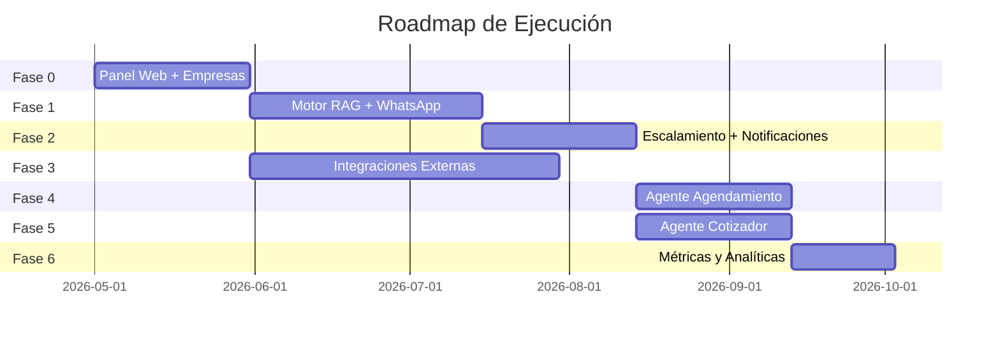

<div align="center">

<!-- Header Banner -->


<!-- Badges -->
<p>
  
  
  
  
  
  
  
  
</p>

<!-- Short Description -->
<p><strong>Plataforma plug & play para configurar, desplegar y gestionar agentes de IA especializados sobre canales de mensajería masiva.</strong></p>

<p>
  <a href="#-inicio-rápido">Inicio Rápido</a> •
  <a href="#-arquitectura">Arquitectura</a> •
  <a href="#-estructura-del-proyecto">Estructura</a> •
  <a href="#-desarrollo-local">Desarrollo</a> •
  <a href="#-despliegue">Despliegue</a> •
  <a href="#-documentación">Docs</a>
</p>

</div>

---

## 🎯 Visión del Producto

> Permitir a empresas activar agentes de IA como módulos configurables sobre WhatsApp, sin desarrollo custom, desde un panel de administración intuitivo.

<table>
<tr>
<td width="33%" align="center">
  
  <br /><strong>Panel Web</strong>
  <br /><sub>Gestión de agentes, métricas e inbox</sub>
</td>
<td width="33%" align="center">
  
  <br /><strong>Cloud Native</strong>
  <br /><sub>Lambdas + Fargate en AWS</sub>
</td>
<td width="33%" align="center">
  
  <br /><strong>Multi-Agente</strong>
  <br /><sub>RAG, Cotizador, Agendamiento</sub>
</td>
</tr>
</table>

---

## ⚡ Inicio Rápido

### Prerequisitos

| Herramienta | Versión | Instalación |
|-------------|---------|-------------|
| Node.js | >= 18 | [nvm](https://github.com/nvm-sh/nvm) |
| pnpm | >= 9.x | `npm install -g pnpm` |
| Docker | Latest | [Docker Desktop](https://www.docker.com/products/docker-desktop/) |
| AWS CLI | v2 | [AWS CLI](https://aws.amazon.com/cli/) |
| SST CLI | v3 | [SST Docs](https://sst.dev) |

### Instalación

```bash
# 1. Clonar el repositorio
git clone https://github.com/tu-org/multibotagents.git
cd multibotagents

# 2. Instalar dependencias
pnpm install

# 3. Verificar que todo compila
pnpm run type-check

# 4. Build completo
pnpm run build
```

---

## 🏗 Arquitectura

```
┌─────────────────────────────────────────────────────────────────────┐
│                         CLIENTES                                     │
│   📱 WhatsApp Business API    🌐 Panel Web (Next.js 15)             │
└──────────────┬────────────────────────────────┬─────────────────────┘
               │                                │
┌──────────────▼────────────────────────────────▼─────────────────────┐
│                        AWS CLOUD (us-east-1)                         │
│                                                                      │
│  ┌─────────────────────┐    ┌──────────────────────────────────┐    │
│  │   API Gateway        │    │   CloudFront + S3                 │    │
│  │   (REST/WebSocket)   │    │   (Frontend SSR)                  │    │
│  └──────────┬───────────┘    └──────────────────────────────────┘    │
│             │                                                        │
│  ┌──────────▼───────────┐    ┌──────────────────────────────────┐    │
│  │   Lambda Handlers    │    │   ECS Fargate                     │    │
│  │   (TypeScript nativo)│    │   (NestJS Services)               │    │
│  │                      │    │                                    │    │
│  │  • Webhooks          │    │  • API Multi-Bots                 │    │
│  │  • Event processors  │    │  • Agent Engines                  │    │
│  │  • Async tasks       │    │  • Background Workers             │    │
│  └──────────┬───────────┘    └───────────────┬──────────────────┘    │
│             │                                │                        │
│  ┌──────────▼────────────────────────────────▼──────────────────┐    │
│  │                    Shared Layer                                │    │
│  │  📦 @multibotagents/core    (Lógica de negocio)               │    │
│  │  📦 @multibotagents/types   (Tipos compartidos)               │    │
│  │  📦 @multibotagents/db      (Adaptadores de BD)               │    │
│  └──────────────────────────────┬───────────────────────────────┘    │
│                                 │                                     │
│  ┌──────────────────────────────▼───────────────────────────────┐    │
│  │                    Data Layer                                  │    │
│  │  🍃 MongoDB Atlas    ⚡ DynamoDB    🐘 PostgreSQL              │    │
│  └──────────────────────────────────────────────────────────────┘    │
└──────────────────────────────────────────────────────────────────────┘
```

---

## 📁 Estructura del Proyecto

```
multibotagents/
├── 📂 apps/
│   ├── 📂 web/                  → Frontend Next.js 15 (App Router)
│   ├── 📂 functions/            → AWS Lambda handlers (TypeScript nativo)
│   └── 📂 services/
│       └── 📂 api-multi-bots/   → Servicio NestJS en Fargate
│
├── 📂 packages/
│   ├── 📂 types/                → @multibotagents/types — Tipos compartidos
│   ├── 📂 core/                 → @multibotagents/core — Lógica de negocio
│   ├── 📂 db/                   → @multibotagents/db — Capa de BD (adaptadores)
│   └── 📂 config/               → @multibotagents/config — TSConfig + ESLint
│
├── 📂 infra/                    → Infraestructura SST v3 (Ion/Pulumi)
│   └── 📂 src/
│       ├── apis/                → API Gateway definitions
│       ├── databases/           → MongoDB, DynamoDB
│       ├── networking/          → VPC, subnets
│       └── services/            → ECS Fargate services
│
├── 📂 Documentacion/            → Documentación de producto
├── 📂 infra-docs/               → Documentación de infraestructura
├── 📄 sst.config.ts             → Configuración raíz SST
├── 📄 turbo.json                → Pipeline de Turborepo
├── 📄 docker-compose.yml        → Servicios para desarrollo local
└── 📄 pnpm-workspace.yaml       → Definición del workspace
```

---

## 💻 Desarrollo Local

### Opción 1: Desarrollo completo con AWS

```bash
# Terminal 1 — Lambdas con live reload
sst dev --stage tu-nombre

# Terminal 2 — Servicio NestJS
pnpm --filter @multibotagents/api-multi-bots dev

# Terminal 3 — Frontend Next.js
pnpm --filter @multibotagents/web dev
```

### Opción 2: Servicios con Docker

```bash
# Levantar servicios Fargate localmente
docker-compose up

# Solo un servicio específico
docker-compose up api-multi-bots
```

### Comandos útiles

| Comando | Descripción |
|---------|-------------|
| `pnpm run build` | 🔨 Build de todas las apps |
| `pnpm run type-check` | ✅ Verificación de tipos |
| `pnpm run lint` | 🔍 Lint del monorepo |
| `pnpm run clean` | 🧹 Limpiar builds y node_modules |
| `pnpm run dev` | 🚀 Dev mode (todas las apps) |

### Filtrar por paquete

```bash
pnpm --filter @multibotagents/web <comando>
pnpm --filter @multibotagents/core <comando>
pnpm --filter @multibotagents/functions <comando>
pnpm --filter @multibotagents/api-multi-bots <comando>
```

---

## 🚀 Despliegue

### Stages

| Stage | Uso | Política |
|-------|-----|----------|
| `tu-nombre` | Desarrollo personal | Efímero |
| `dev` | Desarrollo compartido | Efímero |
| `prod` | Producción | `retain` en recursos críticos |

### Comandos de deploy

```bash
# Deploy a stage personal
sst deploy --stage tu-nombre

# Deploy a desarrollo
sst deploy --stage dev

# Deploy a producción
sst deploy --stage prod

# Eliminar un stage (⚠️ destructivo)
sst remove --stage tu-nombre
```

### Gestión de secrets

```bash
sst secrets list --stage dev
sst secrets set API_KEY "valor" --stage dev
sst secrets remove API_KEY --stage dev
```

---

## 🧩 Agentes Disponibles

<table>
<tr>
<td width="33%" valign="top">

### 🧠 Agente RAG

Responde preguntas basándose en la base de conocimiento configurada.

- ✅ Consulta documentos
- ✅ Soporte multimedia
- ✅ Memoria temporal
- ✅ Personalidad configurable
- ✅ Escalamiento a humano

</td>
<td width="33%" valign="top">

### 🛒 Agente Cotizador

Gestiona catálogos, cotizaciones y seguimiento de pedidos.

- ✅ Consulta de catálogo
- ✅ Armado de cotizaciones
- ✅ Confirmación de pedidos
- ✅ Seguimiento de estado
- ✅ Notificaciones multi-canal

</td>
<td width="33%" valign="top">

### 📅 Agente Agendamiento

Gestiona citas con integración a Google Calendar.

- ✅ Verificar disponibilidad
- ✅ Agendar citas
- ✅ Recordatorios proactivos
- ✅ Cancelar/Reprogramar
- ✅ Configuración de horarios

</td>
</tr>
</table>

---

## 🛠 Stack Tecnológico

<table>
<tr>
<th>Capa</th>
<th>Tecnología</th>
<th>Propósito</th>
</tr>
<tr>
<td><strong>Frontend</strong></td>
<td></td>
<td>Panel de administración (App Router + RSC)</td>
</tr>
<tr>
<td><strong>API Serverless</strong></td>
<td></td>
<td>Handlers de eventos, webhooks, tareas async</td>
</tr>
<tr>
<td><strong>Servicios</strong></td>
<td></td>
<td>APIs REST en ECS Fargate</td>
</tr>
<tr>
<td><strong>Base de Datos</strong></td>
<td></td>
<td>Almacenamiento principal</td>
</tr>
<tr>
<td><strong>Infra as Code</strong></td>
<td></td>
<td>Infraestructura declarativa (Ion/Pulumi)</td>
</tr>
<tr>
<td><strong>Monorepo</strong></td>
<td></td>
<td>Orquestación de builds y tasks</td>
</tr>
<tr>
<td><strong>Package Manager</strong></td>
<td></td>
<td>Gestión de dependencias del workspace</td>
</tr>
<tr>
<td><strong>Lenguaje</strong></td>
<td></td>
<td>Strict mode en todo el monorepo</td>
</tr>
<tr>
<td><strong>Contenedores</strong></td>
<td></td>
<td>Desarrollo local y deploy de servicios</td>
</tr>
</table>

---

## 📐 Patrones de Arquitectura

| Patrón | Descripción |
|--------|-------------|
| **Handlers nativos** | Lambdas sin framework, tipado directo de eventos AWS |
| **Servicios NestJS** | APIs REST con inyección de dependencias en Fargate |
| **Core aislado** | Lógica de negocio sin dependencias de infraestructura |
| **Adaptador de BD** | Patrón adaptador para MongoDB, PostgreSQL, DynamoDB |
| **Tipos compartidos** | DTOs, interfaces y enums centralizados |
| **Config centralizada** | TSConfig y ESLint base extendidos por cada paquete |

---

## 📚 Documentación

| Documento | Contenido |
|-----------|-----------|
| [01 - Visión General](infra-docs/01-vision-general.md) | Propósito y alcance del proyecto |
| [02 - Estructura](infra-docs/02-estructura-proyecto.md) | Organización del monorepo |
| [03 - Config Raíz](infra-docs/03-configuracion-raiz.md) | Archivos de configuración principales |
| [04 - Configs Compartidas](infra-docs/04-configuraciones-compartidas.md) | TSConfig y ESLint centralizados |
| [05 - Paquetes](infra-docs/05-paquetes-compartidos.md) | Paquetes internos del workspace |
| [06 - Aplicaciones](infra-docs/06-aplicaciones.md) | Apps del monorepo |
| [07 - Infraestructura](infra-docs/07-infraestructura-sst.md) | SST v3 y recursos AWS |
| [08 - Desarrollo Local](infra-docs/08-desarrollo-local.md) | Setup del entorno de desarrollo |
| [09 - Comandos](infra-docs/09-comandos-y-dependencias.md) | CLI y dependencias |
| [10 - Docker](infra-docs/10-docker-y-servicios.md) | Contenedores y servicios |
| [ARCHITECTURE](infra-docs/ARCHITECTURE.md) | Visión completa de arquitectura |

---

## 🗺 Roadmap


---

## 📄 Licencia

ST&T LTDA 2026 —  Todos los derechos reservados.

---

<div align="center">


<sub>Construido con 💜 usando TypeScript, AWS y mucha IA</sub>

</div>
